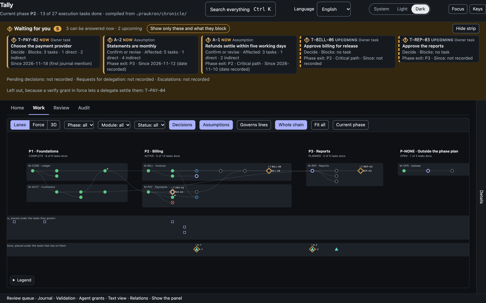
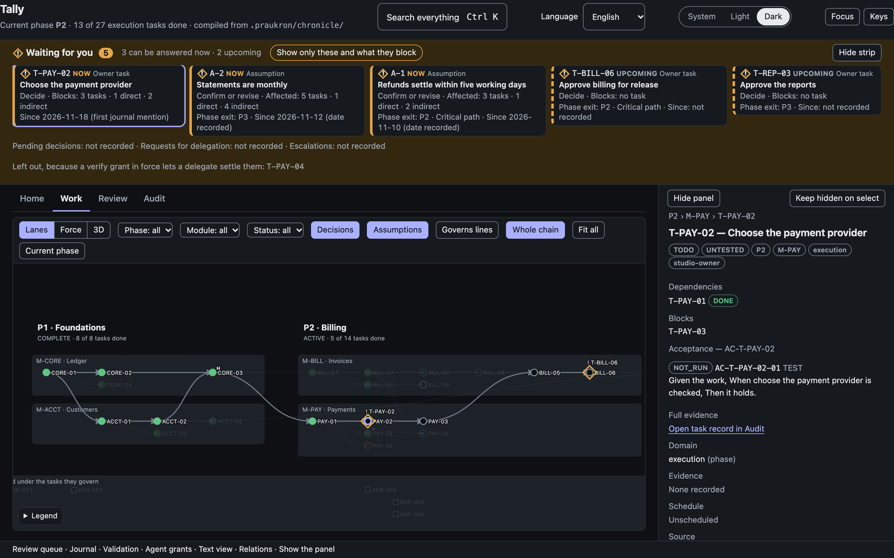
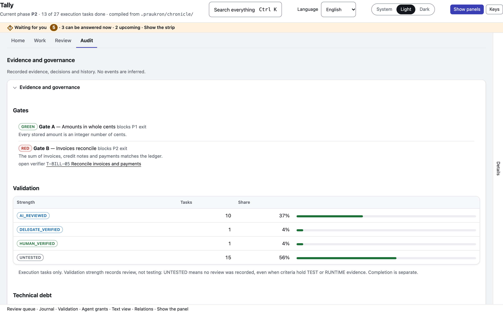
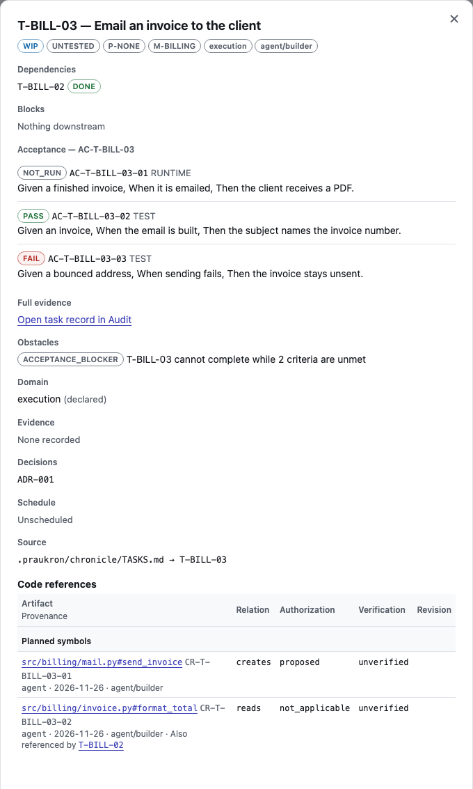
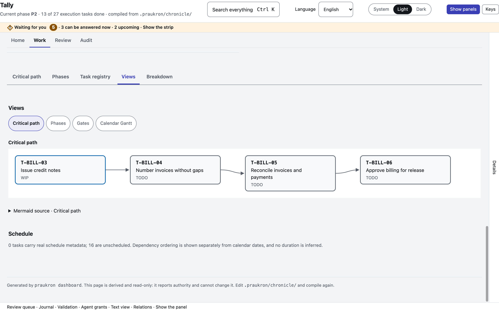
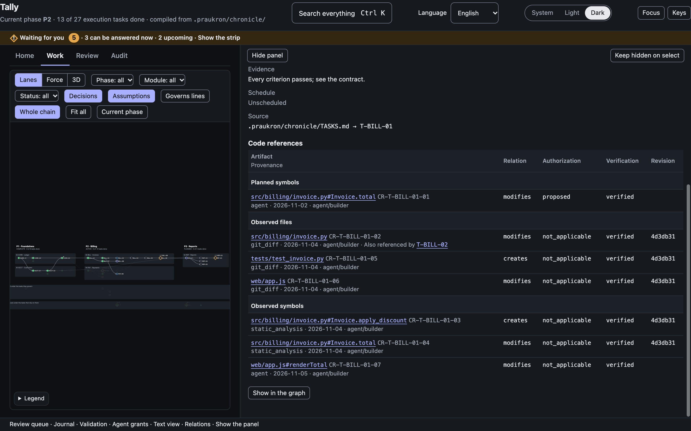
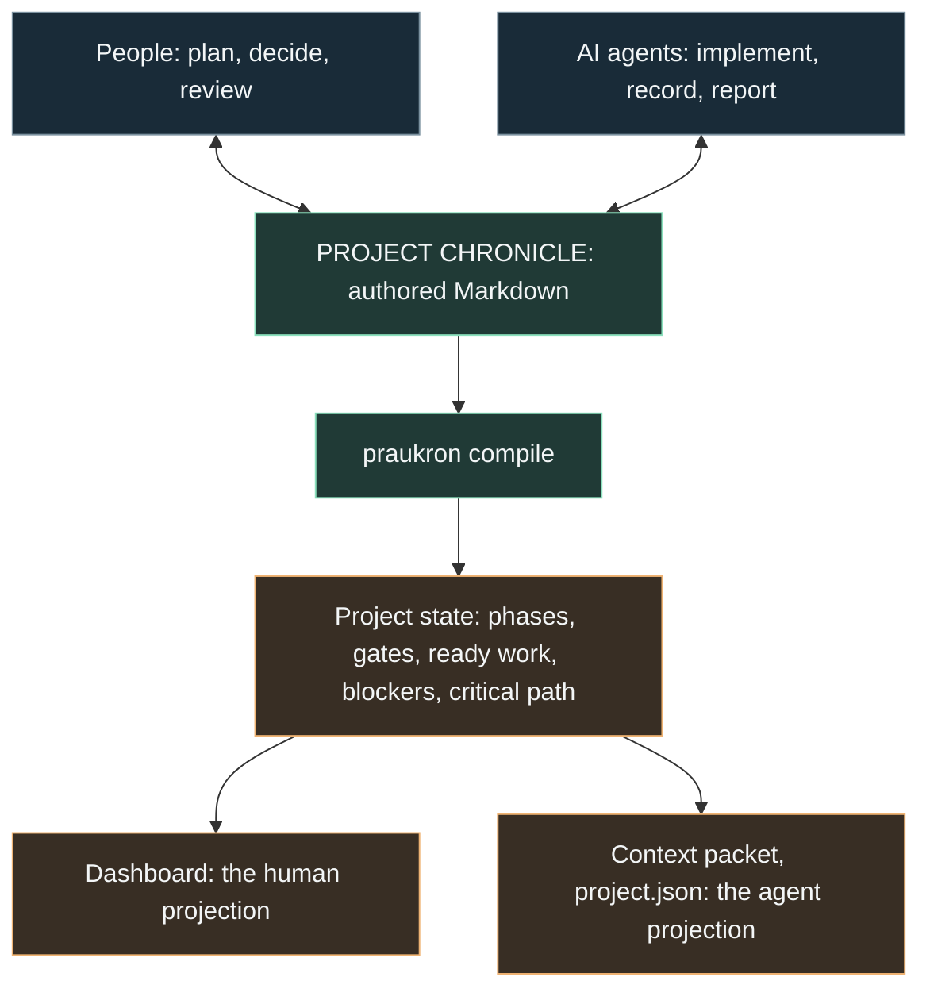

<p align="center">
  
</p>

# Praukron

[](https://doi.org/10.5281/zenodo.22897871)

**Praukron keeps people and AI agents working from the same project state.**

A repository-native project-state protocol and reference implementation for
asynchronous human–AI software development. Praukron is short for Project
Chronicle.

Previously published as **Prokron**. Existing DOI identifiers and Git history are preserved.

[The problem](#the-problem) · [Which work touched which code](#which-work-touched-which-code) ·
[How the code relates to itself](#how-the-code-relates-to-itself) ·
[Get started](#get-started) ·
[Guide](docs/GUIDE.md) · [Specification](docs/SPEC.md) ·
[Thesis](docs/PRODUCT-THESIS.md)

## The problem

A coding session ends. The next one starts somewhere else — a new session, a
different model, another person, a parallel branch. The code survives. What the
code meant does not.

The next participant cannot tell from the repository which task was half
finished, which decision was reversed last month and why, what has to happen
before this work can start, what would have to be true for anyone to call it
done, or which task changed the file in front of them. So they reconstruct it: read the diff, guess the intent, ask someone, or
quietly redo a decision that was already made.

This is usually described as an AI memory problem. It is not, or not only.
A single agent remembering its own conversation does not help the person
reviewing the work, the second agent picking it up, or the teammate who joins in
March. The useful question is not *what should this agent remember* but **what
should the project remember** — and the answer has to be readable by everyone
who touches it.

Praukron's answer: keep that in the repository, as Markdown, and compile it.

## One state, two readers

Your project's phases, tasks, dependencies, decisions and definition of done
live as Markdown inside your repository. A small deterministic tool compiles
those documents into project state, and that state is then projected two ways.

A person opens a page:

<p align="center">
  
</p>

<p align="center"><em><code>praukron dashboard --serve</code> on a synthetic test project. See the <a href="docs/dashboard-ux.md">workspace guide</a> for the interaction model.<br>
Every figure is computed from the Markdown files in <code>.praukron/chronicle/</code>. No model, no service, no network.</em></p>

Home opens with a phase timeline showing state and exact completion counts.
The current-phase card groups its outcome, module progress, gate, root blocker
and active work. The next human action and compact project figures sit alongside
it; on phones, the action follows the timeline. Detailed progress charts remain
in Work. Execution, operations and validation stay separate. Review shows each decision's title,
reason, affected work and action first; one disclosure opens its records and
response options. Both views remain readable without JavaScript.

`praukron dashboard --serve` serves the same page on `127.0.0.1` so the owner
can answer from it. Eligible Review items, and Home's next action, carry a
**Verify** or **Confirm** tick that records the response in one click; **Approve
selected** records several at once, all or nothing. Every answer is written to
`RESPONSES.md` through `praukron respond`, under your `gh` login. The page is in
English or Vietnamese (`--lang vi`, or `Language:` in `THESIS.md`).

An agent asks for a packet, and gets the same state as structured text:

```console
$ praukron context T-PILOT-01
{
  "role": "builder",
  "packetFor": "T-PILOT-01",
  "phase": { "id": "P1", "status": "COMPLETE", "outcome": "..." },
  "task": {
    "id": "T-PILOT-01",
    "status": "DONE",
    "validation": "HUMAN_VERIFIED",
    "dependencies": [ { "id": "T-READINESS-01", "done": true } ]
  },
  "blockers": [],
  "acceptance": [
    { "id": "AC-T-PILOT-01-01", "class": "RUNTIME", "state": "PASS",
      "text": "Given a disposable project and a small specification, When ..." }
  ],
  "decisions": [ { "id": "ADR-008", "title": "Make Praukron an agent working convention" } ],
  "handoff": "..."
}
```

Same project. Different interface. A project meeting and an agent session do not
need two versions of reality, and neither side has to translate for the other.

That is also the whole of it: **Praukron owns project understanding, not project
execution.** Claude, Codex, a person in an editor — they do the work. Praukron
keeps the record that lets each of them know where they are.

### A project story a newcomer can follow

A team is building an expense tool for freelancers. Months in, a new teammate —
or an AI advisor — asks why bank synchronization is absent:

| Question | Recorded answer |
|---|---|
| Why are we building this? | Help freelancers prepare expense records without maintaining a spreadsheet. |
| What did we originally choose? | `ADR-002` proposed bank synchronization to reduce manual entry. |
| Why did the direction change? | `ADR-007` superseded it: launch with CSV import, because supported banks did not cover the first users. Revisit when coverage improves. |
| Where is the project now? | Import is complete; duplicate detection is in progress; validation evidence is linked from the tasks. |
| What comes next? | Finish duplicate detection before starting monthly summaries. The task graph records that dependency. |

The teammate can explain the tradeoff. The advisor can question whether the
constraint still holds. The coding agent can choose work consistent with the
current decision. Nobody has to reconstruct it from commit messages.

*Illustrative example; these are not claims about a deployed project.*

## What the project remembers

Each record answers one question a project keeps being asked.

| The question | What answers it | Where it lives |
|---|---|---|
| What are we trying to do right now? | **Intent** — zero or one active task, at its exact stopping point | `INTENT.md` |
| Why does the project exist? | **Thesis** — the statement every phase, module, and task descends from | `THESIS.md` |
| What work exists? | **Tasks** — module (and through it, phase), owner, status, the commit it was claimed at, validation, evidence | `TASKS.md`, `MODULES.md` |
| Which code did this work touch? | **Code references** — the files and symbols each task planned to touch and, captured from Git when it closed, did touch | `CODE.md` |
| What has to happen first? | **Dependencies**, resolved into a graph of ready and blocked work | computed from `TASKS.md` |
| What counts as done? | **Acceptance** — a frozen contract per task, criterion by criterion | `ACCEPTANCE.md` |
| What phase are we in, and what must be true to leave it? | **Phases** and **gates** — outcome, entry, exit, exit authority | `PHASES.md` |
| What is stopping progress? | **Obstacles**, computed — dependency, acceptance, gate, phase, validation | computed |
| Why did we choose this? | **Decisions** — append-only, superseded rather than rewritten | `ADR/` |
| What happened recently? | **Journal** — progress, what was left mid-air, and why | `JOURNAL.md` |
| Is this product work or support work? | **Domain** — execution advances the project; operations maintains its environment and never counts as progress | `TASKS.md` |
| What ran, failed, or changed along the way? | **Trace** — tool calls, mini-actions, mutations, failures, retries | `TRACE.md` |
| What are we knowingly leaving behind? | **Technical debt** — cost, trigger, exit condition, and the decision that created it | `TECH_DEBT.md` |
| Where should an agent start? | **Index** — generated: what matters now and where each record lives | `INDEX.md` |
| What does the next participant need? | **Handoff** — the baton, overwritten each checkpoint | `HANDOFF.md` |
| Why do we believe any of this? | **Evidence**, recorded against the criterion it satisfies | `ACCEPTANCE.md` |

Nothing here is a status report someone wrote by hand. It is computed from the
authored documents, so it cannot drift away from them.

<p align="center">
  
</p>

<p align="center"><em>What is in flight, what is ready, what waits on a person, what failed, and what blocks the project.<br>
Obstacles are grouped by kind, and an operations task that holds up the path is named as an external blocker rather than joining it.</em></p>

<p align="center">
  
</p>

<p align="center"><em>Audit keeps the evidence, including the operational trace: the support work around the project, the tool calls and commands behind it, what failed, and what was retried.<br>
None of it counts as progress. All of it stays reviewable, because it can explain why execution is stuck.</em></p>

## Done is a contract, not an opinion

A task is not done because someone says it is done. It is done when every
mandatory criterion of its contract holds and its evidence is recorded.

Each criterion is written as Given / When / Then, carries an evidence class
(`TEST`, `MUTATION`, `INSPECTION`, `RUNTIME`, `MANUAL`), and holds a state. A
contract freezes the moment its task starts. Changing it afterwards takes an
Acceptance Change Request, not a quiet edit — and a reviewer's preference is not
an acceptance criterion.

Completion and confidence stay separate. A task can be `DONE` and still be
`UNTESTED`; only a named human may record `HUMAN_VERIFIED`, and only against
manual evidence.

<p align="center">
  
</p>

<p align="center"><em>Click any task for its contract, its criteria, and the evidence behind each one.<br>
One criterion passes, one fails, one has not run — so the task cannot close, and the dialog says why. Below them are the files and symbols the task plans to touch.</em></p>

That last part matters more than it looks. When two people — or two agents —
disagree about whether something is finished, the contract makes the
disagreement **decidable** instead of an argument. Praukron ships an explicit
arbitration order: product authority, then the contract, then invariants, then
accepted decisions, then reproducible evidence, then existing convention, and
only last, reviewer preference.

Taken together, that is as much governance as Praukron has, and it is deliberately
small: decisions are explicit and dated, dependencies are visible, completion has
conditions agreed in advance, conflicting evidence can be surfaced and settled by
a stated order — and no single participant owns the project's context.

### What it refuses to make up

A project tool that invents numbers is worse than no tool. Praukron reports a
duration only when someone recorded one, a date only when someone set one, and
`UNKNOWN` the rest of the time. Dependency ordering and calendar scheduling are
deliberately kept in separate views so one never quietly becomes the other.

Completion is also kept apart from confidence. The validation table counts how
strongly each finished task is actually backed, which is a different question
from whether it is done.

<p align="center">
  
</p>

<p align="center"><em>Six views draw offline: dependencies, critical path, phases, gates, dependency ordering and calendar Gantt.<br>
Each drawing keeps its Mermaid source beside it. Calendar bars use recorded schedules only.</em></p>

## Which work touched which code

A task says what was meant to change. A commit says which lines changed. What
usually goes missing is the link between them. Months later someone opens a
file and asks which task changed this function, under which decision, and
against which acceptance criteria. The reverse question is just as common: a
task is marked done, so what did it actually touch? Commit messages answer
this only when someone remembered to write the task identifier, and an agent
that is asked to record its files by hand forgets as often as a person does.

Praukron records the link itself. When a task is claimed through a structured
write in a Git repository, the claim notes the commit that is checked out.
When the task is closed the same way, the closing write records every file
changed since that commit, the working tree and untracked files included, and
for Python files the functions, classes and methods whose lines changed. They
are written to `.praukron/chronicle/CODE.md` as *observed* references of that
task. There is no extra command to run.

In a small synthetic repository, an agent claims a task:

```console
$ echo '{"id":"T-BILL-01","expectRevision":"d0a71ca157351098","set":{"status":"WIP","owner":"agent/builder"}}' | praukron task update --input -
{"ok":true,"operation":"task.update","recordId":"T-BILL-01",…,"capture":{"status":"recorded","commit":"2ad8fafd1f0d823550701da785b47b0cf984d1c8"}}
```

It changes `src/billing/invoice.py` and `web/app.js`, adds a test, passes the
task's criterion, and closes it:

```console
$ echo '{"id":"T-BILL-01","expectRevision":"ceb70f5ce7896bb5","set":{"status":"DONE","evidence":"AC-T-BILL-01-01 PASS: tests/test_invoice.py"}}' | praukron task update --input -
{"ok":true,"operation":"task.update","recordId":"T-BILL-01",…,"capture":{"status":"captured",
  "references":9,"files":3,"symbols":6,
  "base":"2ad8fafd1f0d823550701da785b47b0cf984d1c8","head":"4d3db3177202fc2329b5e19ea22f36a6f5889573",
  "workingTree":true,"alreadyRecorded":0,"unresolved":0,
  "symbolsUnresolved":[{"path":"web/app.js","reason":"no deterministic symbol extractor for this file type"}]}}
```

Three files and six Python symbols were recorded. `web/app.js` keeps its file
reference, and the reply says why it has no symbols. Either direction can
now be asked:

```console
$ praukron refs T-BILL-01
T-BILL-01 — Apply a discount to an invoice [DONE] — TASKS.md#T-BILL-01
  10 references: 1 planned, 9 observed
  - src/billing/invoice.py#Invoice.total · modifies · planned · unverified · proposed — CODE.md#CR-T-BILL-01-01
  - src/billing/invoice.py · modifies · observed · verified · not_applicable · revision 4d3db31… · evidence: git diff 2ad8fafd1f0d to 4d3db3177202: modified — CODE.md#CR-T-BILL-01-02
  - src/billing/invoice.py#Invoice · modifies · observed · verified · …
  - src/billing/invoice.py#Invoice.__init__ · modifies · observed · verified · …
  - src/billing/invoice.py#Invoice.apply_discount · creates · observed · verified · …
  - src/billing/invoice.py#Invoice.total · modifies · observed · verified · …
  - tests/test_invoice.py · creates · observed · verified · not_applicable · evidence: git diff 2ad8fafd1f0d to the working tree at 4d3db3177202: added — CODE.md#CR-T-BILL-01-07
  - tests/test_invoice.py#DiscountTest · creates · observed · verified · …
  - tests/test_invoice.py#DiscountTest.test_ten_percent · creates · observed · verified · …
  - web/app.js · modifies · observed · verified · … · evidence: git diff 2ad8fafd1f0d to 4d3db3177202: modified; symbols unresolved: no deterministic symbol extractor for this file type — CODE.md#CR-T-BILL-01-10

$ praukron refs src/billing/invoice.py
src/billing/invoice.py — referenced by 2 tasks through 8 references

T-BILL-01 — Apply a discount to an invoice [DONE] — TASKS.md#T-BILL-01
  - src/billing/invoice.py#Invoice.total · modifies · planned · unverified · proposed — CODE.md#CR-T-BILL-01-01
  - src/billing/invoice.py · modifies · observed · verified · …
  …
  criterion AC-T-BILL-01-01 [PASS] — ACCEPTANCE.md#AC-T-BILL-01

T-BILL-02 — Round totals to cents [DONE] — TASKS.md#T-BILL-02
  - src/billing/invoice.py · modifies · observed · verified · …
  - src/billing/invoice.py#format_total · modifies · observed · verified · …
  decision ADR-001 [ACCEPTED] Round invoice totals half up to whole cents — ADR/ADR-001.md
  criterion AC-T-BILL-02-01 [PASS] — ACCEPTANCE.md#AC-T-BILL-02
```

The first reference is *planned*: the agent wrote it with `praukron ref add`
before starting, to say what it expected to touch. Planned and observed
references sit side by side and neither replaces the other. Neither one is
permission to make the change, either: a planned change stays `proposed`
until an owner response or an accepted decision authorizes it.

An agent that picks the task up later gets the same references in its packet,
with the paths and symbol names it can start searching from:

```console
$ praukron context T-BILL-01
{
  …
  "references": {
    "total": 10,
    "counts": { "planned": 1, "observed": 9 },
    "first": [
      { "id": "CR-T-BILL-01-06", "path": "src/billing/invoice.py", "symbol": "Invoice.total",
        "relation": "modifies", "scope": "observed", "verification": "verified",
        "authorization": "not_applicable", "revision": "4d3db3177202fc2329b5e19ea22f36a6f5889573",
        "evidence": "git diff 2ad8fafd1f0d to 4d3db3177202: method Invoice.total modified (Python ast)",
        "authority": "CODE.md#CR-T-BILL-01-06" },
      …
    ],
    "rest": null
  }
}
```

A person sees them in the dashboard: the task list counts each task's Files and
Symbols, and every task carries a Code References section.

<p align="center">
  
</p>

<p align="center"><em>The task from the example above, in <code>praukron dashboard</code>, after the corrections shown in the guide: the planned reference verified, and the JavaScript function added by hand.<br>
Each row says where the reference came from: <code>agent</code> for one written by hand, <code>git_diff</code> for a file and <code>static_analysis</code> for a symbol captured at the close.</em></p>

What the capture does not do, stated where you will meet it:

- **Symbols are captured for Python only** (`.py`, `.pyi`, read with the
  standard library's parser, never imported or run). A file in any other
  language keeps its file reference, and the reply lists it under
  `symbolsUnresolved`. Add its symbols yourself with `ref add`.
- **Two tasks open at once in one working tree cannot be told apart.** Git does
  not record which task made a change. If another task was claimed earlier and
  is still `WIP` or `BLOCKED` when this one closes, every file of the closing
  task is recorded with `Lifecycle: unresolved`, and its evidence names the
  other task, instead of a guess. The exception is a range you name yourself:
  `praukron scope capture <task> --base <rev> --head <rev>` takes your word
  that the range is the task's own, attributes it to the task, marks nothing
  unresolved, and says in the evidence that the range was named by the caller.
  That is how a coordinator whose builders work in other worktrees captures
  each merged task.
- **Caches are left out.** Besides what Git's ignore rules ignore, a capture
  leaves out untracked cache files even when the repository has no ignore rule
  for them: anything under a `__pycache__`, `.pytest_cache`, `.mypy_cache`,
  `.ruff_cache`, `.tox` or `node_modules` directory, and files named
  `.DS_Store` or `Thumbs.db` or ending in `.pyc` or `.pyo`. A tracked file is
  always recorded, and the reply counts what was left out in
  `untrackedLeftOut`.
- **Changes pulled or merged in between count.** A file that arrives through a
  pull or a merge between a task's claim and its close is attributed to that
  task.
- **Capture needs Git.** Without a repository, or for a task that has no
  recorded claim commit, the write still succeeds and its reply says capture
  was skipped and why. A task worked in another worktree or claimed
  elsewhere can be captured afterwards with `praukron scope capture`.
- **No graph provider is needed.** Capture, `refs`, the packet and the
  dashboard use Git and the standard library only. A graph provider such as
  CodeGraph is optional; it is a third-party program, and what it sends over
  the network, telemetry included, is yours to check and handle. Praukron
  itself sends nothing.

How to add a reference by hand, correct one, and read its history is in the
[guide](docs/GUIDE.md#which-code-each-task-touched); the record format is in
[SPEC §2.9](docs/SPEC.md#29-taskcode-references).

## How the code relates to itself

Praukron joins the layer where a project is governed, why it exists, what was
decided and what counts as done, to the layer where its code is written, and
carries both across generations of agents and of people. Two questions are
what that is for: why a piece of code is as it is, from a symbol back to the
tasks and decisions behind it, and what a planned change will run into, the
code within its reach and the decisions attached to that code. The first is
answered: `praukron why <path|path#symbol|directory>` lists the tasks that
touched the code, oldest first, with the decisions behind them, their
criteria and invariants, from the chronicle alone. The second is answered
too: `praukron engine impact <task>` follows the task's files and symbols
through the graph to the code that calls or depends on them, the tasks that
produced that code, and their decisions, frozen criteria and invariants. It
lists what the change must be checked against and does not decide whether the
change conflicts; the reader records the conclusion.

References say which task touched which file and symbol. They do not say how
that code relates to the rest: what a function calls, what calls it, what a
change to it would reach. An optional code graph adds that half. Its purpose
is to see: to look at a task and see the code it touched and that code's
neighbours, or to look at a symbol and see every task that touched it.

It is not there to make an agent find code better. Text search already finds
code, and a small retrieval benchmark run while the engine was being chosen
did not show any graph engine finding code better than plain text search.

The graph comes from a native library built from `native/graph/`:
crowbett/codegraph, which parses with tree-sitter, behind a small C interface.
Praukron loads it in process with Python's `ctypes`. No separate program,
daemon, service or account is involved. Without the library Praukron is
unchanged, and a missing graph is a normal state, not an error. The index the
library writes is derived output like `.praukron/compiled/`: no record cites
it, and `validate`, `compile`, `context` and `retrieve` never read it.

<p align="center">
  
</p>

<p align="center"><em>The layers of the design, in the order a question falls through them. Each answer names the layer it came from.<br>
In <code>main</code> today: the resolved graph, recorded reasoning, and task–code references, joined by <code>praukron engine map</code>. Definitions are planned.</em></p>

The design has five layers, from most certain to most general. A question
falls through them in this order and stops at the first one that answers, and
the answer says which layer it came from:

1. **Resolved graph.** Calls, imports, inheritance and references between
   symbols, with paths and lines, computed by the embedded engine.
2. **Recorded reasoning.** A relation the engine left unknown, worked out by an
   agent reading the code and written as a task–code reference with source
   `agent`, its evidence and confidence. It stays unverified until someone
   checks it.
3. **Definitions.** What a file defines, from the tree-sitter grammars inside
   the library, without resolving anything. Planned, TypeScript and Rust first.
4. **Task–code references.** Which task touched which file and symbol, as
   described above.
5. **Text search.** Anything by name, with your own tools.

What the engine computed, what an agent reasoned, what Git capture recorded
and what a person wrote are shown apart and never blended. Where the engine
cannot tell which function a call reaches, the relation is shown as unknown,
never as no relation.

An agent is part of the design because tools give only the certain part. An
agent can read a function and tell which class a value belongs to, follow a
registry or a hook, or trace a value from input to storage; no engine that
was evaluated could. What Praukron adds is that the agent writes down what it
found, with its source, evidence and confidence, so the work is not repeated
and can be checked. It does this only for the symbols of the task in hand, so
the map fills in along the lines of real work. Where the engine leaves an edge
of a task's symbol unresolved, `engine map` and the agent's work instructions
tell the agent to read the code and record what it finds with `ref add` and
source `agent`.

Five commands exist today:

```sh
praukron engine status     # is a library present, which engine commit and interface version
praukron engine index      # build or refresh .praukron/engine/graph.db
praukron engine export     # the whole graph as one JSON document
praukron engine map <task|path|path#symbol> [--json]
                           # a task's code and its neighbours, or a symbol's tasks, by source
praukron engine impact <task> [--depth N] [--exact] [--json]
                           # what the task's change runs into, grouped by decision
```

`engine map` labels every item by its source: `engine`, `engine-unresolved`,
or `reference:` and the reference's own source. Below the task or path it
names, it says which index it read and when that index was built. Without an
index it answers from the references alone and says that no graph is present.

`engine impact` starts from the task's references, planned and observed, and
follows the edges into them backwards, two steps unless `--depth` says
otherwise, and says how many nodes it reached. Every path carries the marks of
its edges; `--exact` follows `exact` edges only. It groups what it reached by
decision: for each, the tasks and code through which the change reaches it,
with the shortest path spelled out, then their frozen criteria and invariants.
The task's own decisions are listed apart, a superseded decision is shown as
superseded, and each link says how its reference was recorded. A reference
with no node, or an unresolved edge on the code it follows, makes further
reach unknown, and the answer says so on the item. Without an index it covers
only the code the task references and says that reach through the graph is
unknown.

What is not there yet, and the limits of what is:

- **The installer does not deliver the library.** Today you download the
  `praukron-graph-<platform>` artifact of the `Graph library` workflow and put
  the file at `.praukron/lib/<platform>/`, or name it in `PRAUKRON_GRAPH_LIB`.
  The library is a built file and does not belong in the repository. Nothing
  ignores `.praukron/lib/` yet, so keep it out of your commits by hand for now.
  It is built for macOS ARM64 and x86_64 and Linux x86_64 and ARM64; the Linux
  builds need glibc 2.39. Windows is out of scope.
- **Most method calls in Python stay unresolved.** On this repository the
  engine resolved about 30 % of the edges that are not imports; most of the
  rest are method calls on a value whose type it does not know. A relative
  `from . import x` is attributed to the package file. SQL is not indexed.
- **A resolved edge can be wrong.** On Rust (ripgrep 16.0.0, 105 files) the
  engine resolved 51 % of the non-import edges. An independent audit of a
  sample found 28 of 30 resolved call edges right and 2 wrong, 14 of 30
  unresolved edges to be misses inside the workspace, and 7 of 30 definitions
  with a shortened qualified name. The engine marks each edge `exact` or
  `likely`, and `engine map` and `engine impact` show which.
- **Planned, in this order:** symbols of TypeScript and Rust, then the other bundled languages,
  recorded at a task's close; a view of the map in the dashboard; a built-in
  search fallback; the library delivered by the installer and the release; a
  container fallback for machines without the native library, and a
  PostgreSQL store for large codebases.

<p align="center">
  
</p>

<p align="center"><em>A task map: one task, the symbols it touched, their neighbours, a relation marked unknown and one recorded by an agent.<br>
<code>praukron engine map &lt;task&gt;</code> gives it as text, or as JSON with <code>--json</code>; a view of it in the dashboard is planned.</em></p>

The data flow and user flow of a program are not produced by the engine; where
they are wanted, people and agents record them. The graph does not replace
reading the code, a language server or a type checker. How to get the library,
where the index lives and what its figures mean are in the
[guide](docs/GUIDE.md#the-embedded-graph-library-optional); the normative part
is [SPEC §2.10](docs/SPEC.md#210-the-code-graph).

## Get started

### 1. Install in your project

From the root of your project:

```sh
curl -fsSL https://raw.githubusercontent.com/qomero/praukron/main/install.sh | sh
```

Read the script before you pipe it to a shell, as you should with any installer
delivered this way.

The installer adds one directory, `.praukron/`, holding the chronicle, the
compiled views, the tool itself and the portable workflows. Outside it, it
writes only what an agent host reads by fixed address: `AGENTS.md`,
`CLAUDE.md`, and the command files for Codex, Claude Code, and OpenCode. It
preserves existing records and custom instructions, restores missing files, and
prints what to run next.

It also puts a small `praukron` launcher in a directory already on your `PATH`,
so the command is `praukron` from anywhere in the project. The launcher runs
each project's own copy, so two repositories on different releases stay
independent. It creates no directories, changes no shell configuration, and
never replaces a `praukron` it did not write — if there is nowhere to put it,
the installer says so and `.praukron/praukron` works exactly the same. Pass
`--no-link` to skip it.

It runs on Linux, macOS and Windows with Python 3.9 or newer. On Windows, run
the installer from Git Bash; afterwards `praukron` works in Git Bash,
PowerShell and cmd alike, through a `praukron.cmd` beside each launcher. The
tool finds a real interpreter under `py`, `python3` or `python`, so the
Microsoft Store `python3` placeholder does not get in the way.

<details>
<summary>Starting a new project, installing from a checkout, or using the GitHub CLI</summary>

Installing defaults to `existing`, which records from now on. A **new project**
starts from your product specification instead:

```sh
curl -fsSL https://raw.githubusercontent.com/qomero/praukron/main/install.sh | sh -s -- new
```

From a downloaded or cloned Praukron checkout, installation works offline:

```sh
sh ./install.sh /path/to/your/project
```

With an authenticated [GitHub CLI](https://cli.github.com/):

```sh
gh api -H 'Accept: application/vnd.github.raw+json' 'repos/qomero/praukron/contents/install.sh?ref=main' | sh
```

Every form takes an optional `new` or `existing`, an optional target
directory, and `--no-link`. A download installs the latest published release;
`--ref <tag|branch>` picks another, and `--allow-downgrade` permits installing
an older runtime over a newer one.

</details>

### 2. Start in your agent chat

| Agent host | Existing project | New project |
|---|---|---|
| Codex | `$praukron init existing` | `$praukron init new` |
| Claude Code / OpenCode | `/praukron-init existing` | `/praukron-init new` |
| Other capable coding agents | Read `AGENTS.md`, then follow `.praukron/commands/praukron-init.md` in existing mode. | Same instruction, in new mode. |

**New project:** the agent works from your product specification with you to
derive the initial phases, tasks, dependencies, and contracts.
**Existing project:** the chronicle starts empty and records from now on.
Earlier history is reconstructed only if you explicitly ask; Praukron does not
invent it. A populated chronicle is preserved if you initialize again.

### 3. Work normally

Ask for the work you want. The installed rules instruct the agent to create the
task before implementing, write its contract, append a decision when one is
made, and keep progress current — without a slash command for every update.
When the agent closes the task, the files and symbols it changed are recorded
with it.

Then check it yourself:

```sh
praukron status
praukron dashboard && open .praukron/compiled/dashboard.html
```

A session then looks like this, and the loop is the point:

```text
you ask for work  →  agent claims a task, writes its contract, implements
                  →  agent records evidence, decisions, and where it stopped
                  →  praukron compile          state is recomputed
                  →  you read the dashboard   the next agent reads the packet
```

Use the chronicle in discussion and review, too: ask why a decision was made,
what changed, or which work actually serves the current goal.

## Asking the project questions

The tool is standard-library Python. No dependencies, no package to install, no
model provider, no network. To capture a task's files and symbols it runs the
`git` already on your machine; everything else works without Git. Output for a given
set of documents is identical every time, which is what lets two agents and a
person agree on the numbers.

```console
$ praukron status
Praukron — phase none
  tasks        53 / 53
  acceptance   146 / 146 criteria passing
  validation   20 / 53 reviewed or verified
  gates        6 / 6 green
  P0           14 / 14 · COMPLETE
  P1           10 / 10 · COMPLETE
  P2           17 / 17 · COMPLETE
  no phase     12 tasks

  WIP       none
  Ready     none
  Blocked   none
```

That is this repository at v0.4.6, reporting its own unfinished work.

```console
$ praukron explain T-PILOT-01
T-PILOT-01 — Run the continuity pilot
  phase P1 · DONE · HUMAN_VERIFIED

  Dependencies
    ✓ T-READINESS-01

  Acceptance
    ✓ AC-T-PILOT-01-01 [RUNTIME] Given a disposable project and a small specification, When Praukron is installed in `new` m
    ✓ AC-T-PILOT-01-02 [RUNTIME] Given an ordinary work request carrying no Praukron command, When an agent acts on it, Then
    ✓ AC-T-PILOT-01-03 [RUNTIME] Given a material choice that is later changed, When the agent records it without `/praukron
    ✓ AC-T-PILOT-01-04 [RUNTIME] Given work paused partway, When the chronicle is read, Then state, intent, and journal car
    ✓ AC-T-PILOT-01-05 [RUNTIME] Given a fresh agent session with no prior chat, When it is asked to resume, Then it states
    ✓ AC-T-PILOT-01-06 [RUNTIME] Given a populated chronicle, When initialization runs again, Then tasks, ADRs, and journal
    ✓ AC-T-PILOT-01-07 [MANUAL] Given a person who did not do the work, When they read the same chronicle, Then they can e

  Evidence: All seven criteria pass, recorded in `docs/pilot-2026-09-22.md`. The pilot was run in full against v0.4.0 across two disposable projects: Codex CLI 0.155.1 for install, work without a command, a decision and its reversal, stopping partway, and re-initializing over populated history; a Gemini 3.8 Flash session with no prior chat for a cold resume; and the product owner for the human reading. It supersedes the partial run of 2026-09-21, which was measured against v0.2.1 and cites an entry point and a directory that no longer exist. Two things remain unproven and are recorded as unproven: no host exposed a real limit warning to observe, and nothing was simulated in its place; and step 7 passed on the owner's attestation without a point-by-point account or a comparison against an agent's reading.
  Source:   TASKS.md → T-PILOT-01
```

| Command | Answers |
|---|---|
| `praukron status` | Where the project stands, what is ready, what blocks it. |
| `praukron explain <task>` | Why one task exists, its criteria, blockers, and evidence. |
| `praukron context` | Orientation for a fresh agent: phase, work in flight, ready, blocked, the critical path, and where authority lives. |
| `praukron context <task>` | The minimal packet an agent needs to start that task, with the exact records to read and any references that do not resolve. |
| `praukron domains` | How each task's execution/operations domain was decided, and which need one. |
| `praukron refs <task>` | The task's files and symbols, planned and observed, each with its record. |
| `praukron refs <path>` · `<path>#<symbol>` | Every task that references the file or symbol, with its decisions, criteria and assumptions. |
| `praukron why <path>` · `<path>#<symbol>` · `<directory>` | Why the code is as it is: the tasks that touched it, oldest first, how each reference was recorded, the decisions behind them (a superseded one with what replaced it), their criteria and inherited invariants, each with its record. From the chronicle alone; `--json`. |
| `praukron retrieve "<question or id>"` | Only the chronicle records a question needs, routed by `INDEX.md`, each with its source, within a token budget (`--budget`). |
| `praukron archive plan <phase>` | Owner only, read-only: which closed records of a COMPLETE phase (or `P-NONE`) would move to `archive/<phase>/` and which stay and why, with a digest. |
| `praukron archive apply <phase> --plan <digest>` | Owner only: move exactly that plan. They stay authority; open work stays put; a stale plan is refused. |
| `praukron archive restore <phase>` | Owner only: return an archive's records to the working files. |
| `praukron task add --input -` | Append a task, with its new contract in the same validated write. |
| `praukron task update --input -` | Change one task's status, owner, claim date, evidence or validation (never `HUMAN_VERIFIED`), or add governing ADRs (ADR-074); `DONE` needs every criterion `PASS`. In a Git repository a claim records `Claimed at` and a close captures the changed files and Python symbols into `CODE.md`. |
| `praukron contract add --input -` | Give a `TODO` task its acceptance contract. |
| `praukron criterion set --input -` | Record one criterion's state and one-line evidence. |
| `praukron journal append --input -` | Append one dated journal entry; a repeat is refused. |
| `praukron acr add --input -` | Record an Acceptance Change Request against a frozen criterion, for the owner to decide (ADR-076). |
| `praukron ref add --input -` | Record one task–code reference by hand: a planned file or symbol, or one capture could not name. |
| `praukron ref set --input -` | Verify a reference or change its lifecycle or evidence in place, or append a record that withdraws or replaces it. |
| `praukron ref history <CR-id>` | A reference and every record it replaces, oldest first. |
| `praukron scope capture <task> --base <rev>` | Capture a task's changed files and symbols between two revisions, for work claimed elsewhere or in another worktree. |
| `praukron batch apply --input -` | Apply several of the writes above in one call, in order, all or nothing (ADR-077). |
| `praukron codegraph status` | Optional: whether CodeGraph is available to add code structure after the records. |
| `praukron engine status` | Optional: whether the embedded graph library is present, where it was found, and the engine commit and interface version it reports. Without one it says so and succeeds; see the guide for where it is looked for. |
| `praukron engine index` | Index this repository with the graph library into `.praukron/engine/graph.db` (derived, ignored by Git, never authority), or refresh it after edits; `--full` re-reads every file. |
| `praukron engine export` | The whole graph, every node and edge with kinds, paths and lines and the library's own counts, as one JSON document on standard output or to `--output <file>`. |
| `praukron engine map <task\|path\|path#symbol>` | A task's files and symbols with the engine nodes they match, the resolved edges among them and to their direct neighbours, and the edges the engine left unresolved; or the tasks and neighbours of a file or symbol. Every item names its source (`engine`, `engine-unresolved`, `reference:<Source>`). Reads the index with `sqlite3` alone, needs no library, and without an index answers from the references alone; `--json` |
| `praukron engine impact <task>` | What a planned change runs into: from the task's files and symbols, the code that calls or depends on them to `--depth N` steps (default 2; `--exact` follows `exact` edges only), the tasks whose references lie on that code, and their decisions, frozen criteria and invariants, grouped by decision with the shortest path to each. Unknown reach is marked on its item; without an index it covers only the task's own code. A list to check the change against, not a verdict; `--json`. |
| `praukron validate` | Broken dependencies, dangling references, authority conflicts. |
| `praukron compile` | Rebuilds `.praukron/compiled/` from the authored documents. |
| `praukron graph` | The six Mermaid views of the same state. |
| `praukron dashboard` | Four workspaces: Home, Work, Review and Audit, with offline global search. |
| `praukron dashboard --serve` | Serve the dashboard on `127.0.0.1` behind a per-session token so the owner can answer from Review: response forms, one-click Verify/Confirm ticks and atomic "Approve selected". |
| `praukron dashboard --lang vi` | Render the dashboard in Vietnamese; overrides the optional `Language:` field in `THESIS.md`. Also works with `--serve`. |
| `praukron respond <target> <action>` | Owner only: append `CONFIRM`, `REVISE`, `REJECT`, `GUIDE` or `VERIFY` for an assumption or task to `RESPONSES.md`, signed with the active `gh` login; `--batch` writes several, all or nothing. |
| `praukron migrate` | Moves a chronicle written under an earlier layout into the current one. |

The eight write commands, from `task add` to `ref set`, take a JSON payload
(`--schema` prints it, `--dry-run` previews), validate before and after, and
refuse stale revisions; agents use them instead of editing `TASKS.md`,
`ACCEPTANCE.md`, `JOURNAL.md` or `CODE.md`. `batch apply`
combines them into one ordered atomic write and one refresh. See the
[guide](docs/GUIDE.md#writing-records-without-editing-files).

## How it works



People set direction, decide tradeoffs, and accept or reject completion. Agents
implement, record what they did, and produce evidence. Both maintain the same
files, and the compiler turns those files into the same state for everyone.

Because the compiler is deterministic, two agents reading the same project
return the same answer, and a person checking their work reads the same figures.
That is what "same language" means here: not a shared summary, but a shared
source and a shared way of computing from it.

### What lives where

Everything Praukron installs is inside one directory, and only one part of it is
authoritative.

```text
.praukron/
├── chronicle/   written by people and agents; the only source of truth
├── compiled/    generated; safe to delete and rebuild
├── commands/    the workflows an agent follows
├── runtime/     the tool's own code
└── praukron      the command
```

| File in `.praukron/chronicle/` | What it holds |
|---|---|
| **`ACCEPTANCE.md`** | The bar: what must be demonstrated before work counts as done. |
| **`ADR/`** | The reasoning: append-only decisions and their supersession chain. |
| `THESIS.md` | The purpose: the product thesis every phase, module, and task descends from. |
| `PHASES.md` | The arc: maturity stages, exit conditions, exit authority, and gates. |
| `MODULES.md` | The decomposition: modules, each inside one phase or `P-NONE`. |
| `TASKS.md` | The work: module, domain (execution or operations), owner, dependencies, status, the claim date and `Claimed at` commit, validation, evidence. |
| `CODE.md` | The code: which files and symbols each task planned to touch and was observed to touch. Written through `ref add`, `ref set` and the capture at a task's close. |
| `INTENT.md` | The focus: zero or one active task and its exact execution point. |
| `HANDOFF.md` | The baton: what the next person or agent needs right now. |
| `JOURNAL.md` | The diary: progress, validation, what was left mid-air, and why. |
| `TRACE.md` | The operations trace: tool calls, commands, mini-actions, changes, failures, retries. |
| `TECH_DEBT.md` | The liabilities: known compromises, what they cost, their trigger, and what would retire them. |
| `INDEX.md` | Generated, never edited: the map an agent reads first, pointing to the records that matter now. |

`.praukron/compiled/` holds the generated views: a state snapshot, the task
graph, a `project.json` for other tools, Mermaid diagrams, and the dashboard.
Delete that directory and `praukron compile` rebuilds it byte for byte. Nothing
in it is authority, and nothing in it decides a question the authored files
answer.

Praukron is built with Praukron; the dashboard images above use a synthetic test
fixture. The project's own chronicle is private, so a
clone carries the tool and the [chronicle template](templates/chronicle/) but
not the project's working records.

The [specification](docs/SPEC.md) defines the record format, the working
lifecycle, and the invariants. The [product thesis](docs/PRODUCT-THESIS.md) goes
into why the model is shaped this way.

## What is verified, and what is not

**Implemented and tested.** The compiler and its twenty-two commands, acceptance
contracts with evidence, phases, gates, computed obstacles, the critical path,
the dashboard, the execution/operations split, technical debt, the index and retrieval, optional CodeGraph, the optional embedded graph library's `engine` commands, and the context packet, assumptions, owner responses and the served review page, and task–code references with their capture from Git at a task's close. 1186 unit tests plus an installer
regression suite, and deleting the compiled directory reproduces every generated
file byte for byte:

```sh
rm -rf .praukron/compiled && praukron compile && praukron graph
```

Two different coding agents have audited the same implementation against the
same contract and reached the same verdicts, after a real disagreement that the
arbitration order settled.

**Not yet proven.** Praukron's rules ask an agent to checkpoint before a handoff,
compaction, session end, or any known or estimated context, token, time, rate,
or quota limit. **Praukron cannot read hidden quota counters or guarantee a
final write after an abrupt cutoff.** The
[continuity pilot](docs/SPEC.md#handoff-pilot) has now been run in full against
the earlier Prokron continuity workflow and all seven of its criteria pass
([results](docs/pilot-2026-09-22.md)) — but no host exposed a real limit
warning to observe, and nothing was simulated in its place. Checkpointing
against an actual quota boundary is therefore still untested rather than
passed. The human reading also passed on the owner's attestation, without a
point-by-point comparison against an agent's account of the same chronicle.

**Designed, not built.** GitHub-account-based owner identity and interactive
verification remain planned. This release records owner guidance; it does not
claim those identity checks are implemented.

Run the checks yourself from a checkout:

```sh
sh tests/install.sh
python3 -m unittest discover -s tests
```

## Commands

Use these when you want to invoke a workflow explicitly.

| Purpose | Claude Code / OpenCode | Codex |
|---|---|---|
| Initialize | `/praukron-init [new\|existing]` | `$praukron init [new\|existing]` |
| Start or continue a task | `/praukron-work [task]` | `$praukron work [task]` |
| Record or supersede a decision | `/praukron-decide [decision]` | `$praukron decide [decision]` |
| Save a handoff | `/praukron-checkpoint` | `$praukron checkpoint` |
| Recover current work | `/praukron-resume` | `$praukron resume` |
| Record decisions an existing codebase already depends on | `/praukron-baseline` | `$praukron baseline` |

All workflows also install as portable Markdown prompts in
`.praukron/commands/`, which any capable agent can follow directly.

### Use the model you prefer

Praukron configures the **agent host** that reads files and does the work. GLM,
MiniMax, Mistral, Grok, and other models use the same chronicle through a
compatible host; provider setup and model selection stay with that host.

Codex receives a project skill. Claude Code and OpenCode receive project
commands. Hosts that load [`AGENTS.md`](https://agents.md/) can follow the shared
rules; for other capable agents, ask them explicitly to read it and follow the
relevant file in `.praukron/commands/`.

For OpenCode setup, see its [providers](https://opencode.ai/docs/providers),
[instructions](https://opencode.ai/docs/rules/), and
[custom commands](https://opencode.ai/docs/commands/) documentation.

## Releases

The current release is v4.0.0. `VERSION` holds it and [`CHANGELOG.md`](CHANGELOG.md) summarises
what changed. Every release from v0.4.6 is archived and citable:
[`10.5281/zenodo.22897871`](https://doi.org/10.5281/zenodo.22897871) always resolves to the latest one, and
[`CITATION.cff`](CITATION.cff) is what GitHub's *Cite this repository* reads.

### Upgrading from an earlier layout

Prokron v0.2 moved authority out of `.prokron/` and into `prokron/` at the repository
root. Prokron v0.3 moved everything it owns back inside `.prokron/`, as
`chronicle/` and `compiled/`. Either way your records are intact but in the old
place, and the tool reports an empty project until you move them:

```sh
praukron migrate           # shows what it would do
praukron migrate --apply   # performs it
```

Coming from v0.2 this is a relocation: every record moves byte for byte and
nothing is rewritten. Coming from v0.1 it is a rewrite — prose acceptance
becomes contracts and one decisions file becomes an ADR directory — so the
originals are archived untouched beside the new ones.

### Updating an installation

Run the same install command again. It installs the latest release and
never touches a chronicle record. For guidance — the workflows in
`.praukron/commands/`, the Claude Code and OpenCode commands, the skill,
`.praukron/chronicle/README.md`, and the Praukron block in `AGENTS.md`:

- anything unedited since the last install is replaced with the new version;
- anything you edited is kept exactly, and the new version is written beside
  it under `.praukron/upgrade/`. Merge what you want, then delete that folder.

The installer lists every file it replaced or staged. It will not install an
older runtime over a newer one unless you pass `--allow-downgrade`, and
`--ref <tag>` installs a specific release.

The rename uses `praukron`, `.praukron/`, and the `praukron` Python package.
Upgrade an existing Prokron installation with the Praukron installer: its
chronicle moves unchanged, and a compatibility alias keeps old paths and
launchers usable. Edited guidance stays intact; review the new guidance staged
under `.praukron/upgrade/`. If both `.prokron/` and `.praukron/` already exist
as separate installations, reconcile them before upgrading.

Published tags from before v1.1.0 still contain Prokron. Use `--ref v1.1.0`
for the first Praukron release; the new installer refuses a pre-rename source
archive rather than reinstalling the old product name.


## Documentation

| Document | What it covers |
|---|---|
| [`docs/GUIDE.md`](docs/GUIDE.md) | Using it day to day: every command, the agent workflows, and what to do when something looks wrong. |
| [`docs/SPEC.md`](docs/SPEC.md) | The record format, working lifecycle, invariants, scope, and the continuity pilot. |
| [`docs/PRODUCT-THESIS.md`](docs/PRODUCT-THESIS.md) | Why shared project state, and how the model is built. |
| [`CONTRIBUTING.md`](CONTRIBUTING.md) | How a change is accepted here: a task, a contract, evidence. |
| [`SECURITY.md`](SECURITY.md) | What is in scope, and how to report privately. |
| [`templates/chronicle/README.md`](templates/chronicle/README.md) | The read order and working rules an agent follows, installed as `.praukron/chronicle/README.md`. |
| [`CHANGELOG.md`](CHANGELOG.md) | What changed in each release. |

## Help improve it

Try the [continuity pilot](docs/SPEC.md#handoff-pilot) in a disposable project.
When reporting a gap, include the host and model, the request, what was
recorded, and what a person or agent could not understand from it. Remove
private project details before sharing.

Changes should keep Praukron small and readable.
[`CONTRIBUTING.md`](CONTRIBUTING.md) describes how a change is accepted — a
task, a frozen contract, and evidence, which is the same workflow the tool
installs. The [specification](docs/SPEC.md) defines the working agreement and
scope.

## Qomero

Built by Qomero, and used to run Qomero's own projects. Praukron is the record of
how we think a human and an AI should share one project.

## License

Apache-2.0. See [LICENSE](LICENSE), [NOTICE](NOTICE), and
[TRADEMARKS.md](TRADEMARKS.md).
