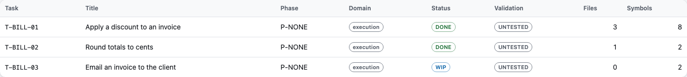

# Using Praukron

A working guide: the commands, the workflows your agent runs, and what to do
on an ordinary day. The [README](../README.md) explains why Praukron exists and
[`SPEC.md`](SPEC.md) defines the records; this is how you drive it.

Every command and flag below was run against a real installation before it was
written down.

---

## Install

From the root of your project:

```sh
curl -fsSL https://raw.githubusercontent.com/qomero/praukron/main/install.sh | sh
```

That adds one directory, `.praukron/`, and the files an agent host reads by a
fixed address — `AGENTS.md`, `CLAUDE.md`, and command files for Codex, Claude
Code and OpenCode. It also puts a `praukron` launcher on your `PATH`, so the
command works from any subdirectory.

| You want | Run |
|---|---|
| An existing project, recording from now on | `… \| sh` |
| A new project, from a product specification | `… \| sh -s -- new` |
| Install into another directory | `sh install.sh /path/to/project` |
| Skip the `PATH` launcher | `… \| sh -s -- --no-link` |
| A specific release, or unreleased `main` | `… \| sh -s -- --ref v0.5.0` · `--ref main` |
| Go back to an older release on purpose | `… \| sh -s -- --ref v0.4.6 --allow-downgrade` |

Without the launcher, every `praukron` below is `.praukron/praukron`. Both always
work; the launcher just saves typing.

The one-line install fetches the latest published release, not `main`, and
runs that release's own installer, so everyone who installs on the same day
gets the same thing.

**Upgrading** is the same command. It replaces the tool, preserves every
record, and refreshes the generated views. Guidance — workflows, host
commands, the skill, the chronicle README, and the Praukron block in
`AGENTS.md` — is replaced if you never edited it; if you did, yours is kept and
the new version is written under `.praukron/upgrade/` for you to merge. The
output lists both. It refuses to install an older runtime over a newer one
unless you pass `--allow-downgrade`.

In a Git repository the installer also keeps a marked block in `.gitattributes`
so `JOURNAL.md` and the ADR index merge cleanly when two branches both append
to them.

---

## The commands

### Asking where the project stands

```console
$ praukron status
App — phase P1
  tasks        1 / 2
  acceptance   1 / 2 criteria passing
  validation   1 / 2 reviewed or verified
  gates        0 / 0 green
  P1           1 / 2 · ACTIVE

  WIP       none
  Ready     T-002
  Blocked   none
  Next      T-002 (critical path)
```

`--limit N` caps how many obstacles it prints.

This is the command to run first, every time. If it disagrees with what you
believe, one of the two is wrong and it is worth finding out which.

### Asking about one task

```console
$ praukron explain T-002
T-002 — Next step
  phase P1 · TODO · UNTESTED

  Dependencies
    ✓ T-001

  Acceptance
    ○ AC-T-002-01 [TEST] Given foundation, When extended, Then it holds.

  Evidence: none recorded
  Source:   TASKS.md → T-002
```

`--json` gives the same thing as data. A `✓` is a satisfied dependency, a `○`
is a criterion with no evidence yet.

### Handing an agent exactly what it needs

```sh
praukron context T-002                   # the builder's packet
praukron context T-002 --role reviewer   # the reviewer's packet, with the finding taxonomy
praukron context T-002 --role coordinator  # the coordinator's packet, with its own conventions
```

When a coordinator runs the work, each packet also carries the task's brief and
the conventions it rests on from `COORDINATION.md`, filtered to the role
(ADR-075).

Emits the intent, phase, task, dependencies and whether they are met, the
acceptance criteria and their states, inherited invariants, governing
decisions, evidence and handoff — and nothing about any other task. Paste it
into an agent that has never seen the repository and it can start. It also
carries the task's domain, any operations work it waits on, and the trace
events that name it.

```sh
praukron domains          # how every task's domain was decided
praukron domains --json   # the same, for tools
```

Lists tasks as explicit or inferred execution, explicit operations, or
ambiguous, names the ambiguous ones, and says whether `TRACE.md` holds any
tool calls, mini-actions, failures, retries, or mutations. It reads only.

### Starting from the index

```sh
cat .praukron/chronicle/INDEX.md                  # what matters now, and where it lives
praukron retrieve "why is P1 blocked?"            # only the records that question needs
praukron retrieve T-095                           # one task's neighbourhood
praukron retrieve T-095 --code                    # then code structure, if CodeGraph is installed
praukron retrieve T-095 --budget 0                # every record, however large the neighbourhood
```

`INDEX.md` is written by `compile`. Never edit it: edits are overwritten and
never read; `validate` says when it is stale. `retrieve` resolves the ids a
question names — or, for "this task", "the phase", "blocked", "debt", the ones
the index marks as current — and prints each record it needs with its source,
and how little of the chronicle that was. It loads records up to about 4000
tokens (`--budget`), most relevant first, and lists the rest as pointers with
the command that fetches each.

### Archiving a closed phase

```sh
praukron archive plan P3                          # read-only: what moves, what stays and why, and a digest
praukron archive apply P3 --plan <digest>         # owner only: move exactly what that plan showed
praukron archive restore P3                       # owner only: bring the phase's archive back
praukron archive plan P-NONE                      # phase-independent work is archived the same way
praukron archive P3 --dry-run                     # the older one-step form (no digest); --dry-run writes nothing
```

`TASKS.md` and `ACCEPTANCE.md` only grow, and so do the lifecycle files beside
them. Once a phase is `COMPLETE` (or for `P-NONE`, which has no status), the
owner can move its closed records, verbatim, into `chronicle/archive/P3/`. They
stay authority: every command reads them as before, `retrieve` labels them with
their new file, and an old `TASKS.md#T-…` pointer still resolves. Agents never
run these commands on their own (ADR-067, ADR-070). The write commands treat
everything under `archive/` as immutable (`archived-record`), so an agent
cannot edit an archived record; only `restore` brings one back.

**Plan, apply, restore.**

- `archive plan <phase>` reads the chronicle and writes nothing. It lists every
  candidate record as `moves` or `stays` with the reason, the files that would
  change, the recovery mode, and a SHA-256 `digest` over every chronicle file's
  bytes, the phase, the recovery mode and the tool version. `--json` prints the
  same as one line.
- `archive apply <phase> --plan <digest>` takes the shared write lock, plans
  again, and applies only if the digest still matches; otherwise it refuses with
  `stale-plan` and writes nothing, so run `plan` again and read it. A missing
  `--plan` is refused (`missing-plan`). The older `archive <phase>` plans and
  applies in one step with no digest; `--dry-run` shows the plan without writing.
- `archive restore <phase>` returns every record in `archive/<phase>/` to its
  working file, in place of eligibility, which is not checked again. It refuses a
  record whose id already exists in a working file (`id-collision`). `--dry-run`
  shows what would return. A phase that has no archive is `unknown-archive`.
- A phase must be `COMPLETE` (`incomplete-phase`) or `P-NONE`, and must exist in
  `PHASES.md` (`unknown-phase`). `archive` refuses unless the chronicle validates
  cleanly first; `restore` validates the state it would write before writing.
- Success refreshes `INDEX.md`, the compiled views and the graphs, and marks
  a rendered dashboard as out of date (ADR-086).
  If the move succeeded but the refresh failed, the result says `written: true`,
  `refreshed: false` and exits nonzero. The records are already moved: re-run
  `compile && graph`, never the archive. A move that cannot be
  verified is undone, byte for byte, before the command returns.

**What moves.** Eligibility is checked once, when `apply` (or the one-step
`archive <phase>`) runs; `restore` never checks it again, and checks only that
no id collides, that the journal order can be kept, and that the restored
chronicle validates. Eligibility looks only at the phase axis: a task's phase comes from its module (`P-NONE` for
phase-independent work), and `Domain: execution` or `operations` never changes
it. No id prefix such as `T-OPS-` means anything to it.

| Record | File | Moves when | Stays when |
|---|---|---|---|
| Task | `TASKS.md` | its phase is the selection and it is `DONE` | an `OPEN` assumption names it, a response to such an assumption awaits reconciliation, a linked debt is not `RESOLVED` or `INVALIDATED`, or an unresolved failure points at it; for `P-NONE` also while a working task depends on it |
| Contract | `ACCEPTANCE.md` | its task moves | a working task still uses it, another contract inherits it, or it holds an inherited invariant |
| Assumption | `ASSUMPTIONS.md` | `CONFIRMED`, `REJECTED`, `REVISED` or `WITHDRAWN`, no response awaits reconciliation, and every task it names is archived or moving | any other status, or a task it names still works. One that names no task is never a candidate |
| Technical debt | `TECH_DEBT.md` | `RESOLVED` or `INVALIDATED`, naming at least one task, all archived or moving | any other status, or a task it names still works; under `P-NONE`, one that names no task is reported as staying |
| Trace event | `TRACE.md` | its task is archived or moving (an event with no task belongs to `P-NONE`) | it belongs to an unresolved failure or retry chain |
| Journal entry | `JOURNAL.md` | it names at least one archivable record, and every record it names (each member of a range) is archived or moving | it names nothing, only ADRs, an open or unknown record, or its heading is duplicated |

A record that names tasks of several phases goes to the archive of the latest of
those phases in `PHASES.md` order, with `P-NONE` last. Each file keeps its line
endings and UTF-8, and each archive file takes the line endings of the file the
records came from.

**What is never archived.** `RESPONSES.md` is the owner's words and stays whole:
a response is evidence that an assumption was answered, and nothing may move it
out from under the assumption. Decision records in `ADR/` stay too: they are
the highest-ranked authority an agent reads, and a journal entry that names only
ADRs names nothing to archive. `COORDINATION.md` stays as well: it is how the
project runs its agents, and a task with an `ACTIVE` brief stays in the working
files with it (ADR-075). `CODE.md` stays whole: a file's history across tasks
is what it records. `INTENT.md`, `HANDOFF.md`, `PHASES.md`,
`MODULES.md`, `THESIS.md` and the gates are state, not history, and also stay.

**Destinations.** `archive/<phase>/` receives `TASKS.md`, `ACCEPTANCE.md`,
`ASSUMPTIONS.md`, `TECH_DEBT.md`, `TRACE.md` and `JOURNAL.md` as the plan needs
them; the shared `archive/JOURNAL.order.json` is described below. `restore`
deletes an archive file once nothing is left in it.

**Later references never matter.** A dependency, response or journal entry written after
the archive may point at an archived record. That is allowed and never blocks
the archive or a later restore: the archived record is still authority.

#### Recovery: Git and no Git

`apply` and `restore` print a recovery procedure before they finish, and also
return it in the `recovery` field of `--json`. Which one depends on the
`mode` the plan shows.

- **Git mode** is used when the chronicle is inside a Git work tree, none of its
  paths is ignored, and no checkout conversion could change its bytes
  (`core.autocrlf`, `filter`, `eol`, `text`, `crlf`, `ident` or `working-tree-encoding`
  attributes). The chronicle must be clean first: modified, staged or untracked
  files stop the command with `dirty-chronicle`. Commit them, then apply. After
  the move, undo it according to where it is:
  - *unstaged:* from the project root, `git restore --source=HEAD --worktree --
    <recovery.changedTrackedFiles>`, then delete every file in
    `recovery.createdFiles` (and any archive directory left empty);
  - *staged:* the same with `--staged` added to the restore, and
    `git rm --cached --ignore-unmatch -- <recovery.createdFiles>` before deleting
    them;
  - *committed:* `git revert <archive-commit>`. The suggested commit message is
    `Archive <phase> chronicle records` (`Restore <phase> chronicle records`
    after a restore).

  The two lists are different and must stay apart. `recovery.changedTrackedFiles`
  holds the existing files Git knows, as paths from the project root.
  `recovery.createdFiles` holds the files the move created, which Git does not
  know yet. The plan's top-level `changedFiles` (relative to `chronicle/`) holds
  both, so passing it to `git restore` fails on the new archive paths: never use
  it for recovery. The exact commands, in `recovery.commands.unstaged`, `.staged`
  and `.committed` and printed for POSIX sh and for PowerShell, are the safest
  way; they use the right list in each place.
- **No-Git mode** is used otherwise, including when conversion could change
  bytes. Before writing, the command copies every original file byte for byte to
  `.praukron/backup/<UTC timestamp>-<id>/`, with a `manifest.json`, and prints a
  command that restores them. The backup is kept, and its folder ignores itself in Git.
  Restoring from it puts back the exact bytes, including files the move created,
  which it removes.
- **Interrupted runs.** Both modes write a durable recovery record first. If a
  process dies mid-move, the next write command rolls the files back and reports
  that an interrupted archive was rolled back; try again.

#### Checking an archive with `validate`

There is no separate `archive verify` command: `praukron validate` checks the
permanent invariants of the archives, and never checks eligibility again,
because eligibility is decided once, when a move is made. It reads the working
files and every `archive/<phase>/` together.

| Invariant | Finding |
|---|---|
| every Markdown file directly in `archive/<phase>/` is a known record file | error `invalid-archive-file`; an archive input that cannot be read: error `invalid-archive-input` |
| nothing else sits in `archive/<phase>/` | warning `unsupported-archive-path` for any other extension, nested path or directory, naming that `restore` refuses it. Only directory listings are read, never file bytes; `archive/JOURNAL.order.json` is the one file outside the phase folders and is checked separately |
| the loader will read the file (right letter case) | warning `case-mismatched-archive-filename` (the file is ignored) |
| every record parses | the load fails with the file and record named |
| no id exists twice across working files and archives | errors `duplicate-task`, `duplicate-event`, `duplicate-assumption`, `duplicate-debt` (a duplicate contract fails the load) |
| references resolve across both | errors such as `unknown-dependency`, `unknown-contract`, `unknown-decision`, `unknown-assumption-reference`, `unknown-debt-reference`; an event naming a missing task or affected record is a warning (`unknown-event-task`, `unknown-event-affects`) |
| every archived journal heading reads `## YYYY-MM-DD — <title>` | error `invalid-journal-heading` |
| no journal heading appears twice across journals | warning `duplicate-journal-heading` |
| every id a journal entry names exists | warning `unknown-journal-reference`. A range such as `T-P0-01..05`, `T-P0-01..T-P0-05` or `ADR-003..005` names each id it spans, and only missing members are reported. A range whose ends differ in stem or tail width (`T-01..5`), run backwards, are not numeric, or span more than 100 ids is one warning naming the range |
| the journal order file agrees with the journals | warning `invalid-journal-order` |
| no recovery record is left behind | error `interrupted-archive` |
| a task sits in its own phase's directory | warning `wrong-archive-phase` |

A dependency, response or journal entry written *after* an archive may point at
an archived record without any finding: the archived record is still authority.

If an `apply` or `restore` wrote the move but refreshing afterwards failed, the
result is `ok: false` with `error.code` `refresh-failed`, `written: true` and
`refreshed: false`, the plan fields (`digest`, `changedFiles`, ...) still
present, and exit code 1. The move is complete and stays. The refresh runs
`compile` (which writes `INDEX.md` and the compiled data), then the graphs, so
run `praukron compile` and `praukron graph` and do nothing else. Never run `apply` again: the plan's digest no
longer matches, and the records are already moved.

#### Journal ordering and repair

Eligible journal entries move with the records they name. The shared
`chronicle/archive/JOURNAL.order.json` remembers the order of unique full
headings once entries are separated across files (ADR-072). Commit it with
the archive in Git mode. It is not a disposable compiled view or a cached
plan: eligibility is recomputed. Never hand-edit its JSON. Journal section
bytes, including line endings and trailing blank lines, remain unchanged.

Dates are the primary placement key. An owner may reorder same-date entries
inside one journal: the observed file order wins and the next journal move
updates the sidecar in the same transaction. Cross-file constraints that
cannot reconcile are held for repair. Backdated entries in a file that is
not chronological may return in date order rather than the original file
order; exact section bytes still match. Undated `##` sections sort before
dated entries during placement; keep journal conventions in the preamble.
The byte guarantee covers complete entry sections, not every preamble: when
all entries have left, insertion trims the preamble's trailing line breaks
to two; a headerless working journal can gain `# Journal` on restore.

`praukron validate` warns about malformed/version-mismatched metadata,
missing coverage of cross-file ties, obsolete headings, order disagreements,
and duplicate journal headings. Warnings do not block unrelated record work.
Archive and restore keep only the journal entries whose cross-file order is
unknown, with a reason and repair step; other records and unrelated dates
can move. Restore refuses a heading duplicated in any journal file.

After renaming or deleting a heading, its old sidecar identity is obsolete.
If the affected date is wholly in one journal, its observed order can rebuild
the metadata. On a split date, a heading absent from the sidecar in the
working journal is new and keeps its position relative to its same-date
working neighbours, including entries naming nothing. Only when no known
same-date working heading constrains it does it follow all known ties.
An absent heading in an archive is lost history: that date stays
pending. Recover matching metadata/headings from Git history or
`.praukron/backup/<timestamp>/`; never fill arrays by guessing. Renaming a
working heading creates a new identity under this rule; a renamed archived
heading requires history repair. Body-only edits retain identity. A rewrite
for another date preserves saved names of a held date, even stale names.

For a deleted or unusable sidecar, first run `validate` and compare against
trusted history. If all headings for every date are together in one
journal, remove the broken sidecar and the next successful journal move
rebuilds it. Otherwise recover matching ordering information from Git or the
backups, reconciling later journal edits before retrying. The first archive's
preimage backup records a new sidecar as absent: use its original journal to
recover order, not a nonexistent sidecar copy. Undoing the whole archive is
safe only when that also preserves subsequent work; metadata repair after
later edits is a separate owner reconciliation. A coherent permutation of
complete cross-file metadata cannot be detected from separated journals
alone, so retain its history and backups.

### Writing records without editing files

Agents record tasks, criterion results, status changes, journal entries and
Acceptance Change Requests with six commands, and code references with two more
(see [Which code each task touched](#which-code-each-task-touched)). Each reads a small JSON payload and prints one JSON line, so the
cost of a write follows the size of the record, not of `TASKS.md` or
`ACCEPTANCE.md` ([SPEC §2.6](SPEC.md#26-structured-writes), measured in
[benchmarks](benchmarks.md)). `--schema` prints a command's payload and an
example, `--dry-run` shows what would be written without writing it, and
`--help` says when to use the command and when not to.

**The starting point.** The examples below form one ordered sequence. Run them
in a scratch project whose chronicle has a thesis statement, this module in
`MODULES.md`, and nothing else (the `Phase: P-NONE` module holds work that
belongs to no phase):

```text
## M-FOUNDATION — Foundation
- Phase: P-NONE
- Outcome: The project can be built and checked.
```

and this task, written by hand at the end of `TASKS.md`. It has no contract
yet (`- AC: none`), so `praukron validate` reports `unknown-contract` until
step 1 adds one:

```text
## T-DOCS-02: Review the guide
- Status: TODO
- Module: M-FOUNDATION
- Domain: execution
- Validation: UNTESTED
- Dependencies: none
- Owner: unassigned
- AC: none
- Evidence: —
- Governed by: none
```

The outputs are what the commands print for LF files; yours differ only in
revisions (a hash of the record's bytes, so CRLF files hash differently) and
dates. JSON output escapes non-ASCII, so `—` prints as `—`. On POSIX the
payload is piped in with `echo '…' | praukron … --input -`; on PowerShell save
the JSON to a file and pass `--input payload.json`.

**1. Give an existing TODO task its contract.** `task add` always writes a
contract or names an existing one, so `contract add` is for a task that was
written by hand or is missing its contract. Take the task's revision first
from `context <task>`, `explain <task>` or `retrieve <task>`. Only for a record
not yet read, sixteen zeros are a fallback: the refusal returns it. The
zero-revision examples below demonstrate that fallback.

```console
$ echo '{"id":"AC-T-DOCS-02","task":"T-DOCS-02","title":"Review the guide","expectTaskRevision":"0000000000000000","criteria":[{"text":"Given the guide, When a reviewer follows it, Then every example runs.","class":"RUNTIME"}]}' | praukron contract add --input -
{"ok":false,"operation":"contract.add","error":{"code":"stale-revision","message":"task has changed; retry with expectTaskRevision 500d120c1d094409","field":"expectTaskRevision"},"written":false,"current":{"recordId":"T-DOCS-02","source":"TASKS.md#T-DOCS-02","revision":"500d120c1d094409","record":"## T-DOCS-02: Review the guide\n- Status: TODO\n- Module: M-FOUNDATION\n- Domain: execution\n- Validation: UNTESTED\n- Dependencies: none\n- Owner: unassigned\n- AC: none\n- Evidence: \u2014\n- Governed by: none\n"}}
$ echo $?
1

$ echo '{"id":"AC-T-DOCS-02","task":"T-DOCS-02","title":"Review the guide","expectTaskRevision":"500d120c1d094409","criteria":[{"text":"Given the guide, When a reviewer follows it, Then every example runs.","class":"RUNTIME"}]}' | praukron contract add --input -
{"ok":true,"operation":"contract.add","recordId":"AC-T-DOCS-02","source":"ACCEPTANCE.md#AC-T-DOCS-02","revision":"e004d9c19957e312","validation":"passed","written":true,"refreshed":true}
```

**2. Add a task with its contract.** One write; either both records appear or
neither does. The `revision` in the result is what the next update of this task
must quote.

```console
$ echo '{"id":"T-DOCS-01","title":"Write the retry guide","module":"M-FOUNDATION","domain":"execution","dependencies":[],"contract":{"id":"AC-T-DOCS-01","title":"Retry guide","criteria":[{"text":"Given a refused write, When the guide is read, Then the next step is clear.","class":"INSPECTION"}]}}' | praukron task add --input -
{"ok":true,"operation":"task.add","recordId":"T-DOCS-01","source":"TASKS.md#T-DOCS-01","revision":"9101852277a8233c","validation":"passed","written":true,"refreshed":true}
```

To record several steps in one call, give `batch apply` an `operations` list.
Each entry is the payload of one of the commands above plus `"op"`, the
command's name. Take the task's and the contract's revisions from
`praukron context T-DOCS-01` once, and give every operation on that record the
same revision:

```console
$ cat done.json
{"operations":[
  {"op":"task update","id":"T-DOCS-01","expectRevision":"0123456789abcdef","set":{"status":"WIP","owner":"worker"}},
  {"op":"criterion set","criterion":"AC-T-DOCS-01-01","expectRevision":"fedcba9876543210","state":"PASS","evidence":"Reviewed the guide."},
  {"op":"task update","id":"T-DOCS-01","expectRevision":"0123456789abcdef","set":{"status":"DONE","evidence":"Guide reviewed; criterion PASS."}},
  {"op":"journal append","title":"Guide complete","body":"Reviewed T-DOCS-01."}
]}
$ praukron batch apply --input done.json
```

Operations run in order under one lock and keep their command's rules; the
batch validates once and refreshes once. If any operation is refused, nothing
is written, and the refusal names its zero-based `index` and its `op`; a stale
revision names the revision to retry the whole batch with. Success lists each
operation's result and the final revision of every section written, keyed by
`file#anchor`. A section an earlier operation in the same batch created, such
as a new task, takes `"$previous"` instead of a revision. `--dry-run` checks the
whole batch without writing, and `praukron batch apply --schema` describes every
operation. If only the refresh fails, rerun `compile` and `graph`.

**3. Claim it.** Take `expectRevision` from the task's `revision` in `context`,
`explain` or `retrieve`, or from the last write result. A stale one is
refused and the refusal returns the current revision and record.

```console
$ echo '{"id":"T-DOCS-01","expectRevision":"0000000000000000","set":{"status":"WIP","owner":"worker"}}' | praukron task update --input -
{"ok":false,"operation":"task.update","error":{"code":"stale-revision","message":"T-DOCS-01 changed: expected revision 0000000000000000, current 9101852277a8233c; retry with currentRevision","field":"expectRevision","currentRevision":"9101852277a8233c","section":"## T-DOCS-01: Write the retry guide\n- Status: TODO\n- Module: M-FOUNDATION\n- Domain: execution\n- Validation: UNTESTED\n- Dependencies: none\n- Owner: unassigned\n- AC: AC-T-DOCS-01\n- Evidence: \u2014\n- Governed by: none"},"written":false}

$ echo '{"id":"T-DOCS-01","expectRevision":"9101852277a8233c","set":{"status":"WIP","owner":"worker"}}' | praukron task update --input -
{"ok":true,"operation":"task.update","recordId":"T-DOCS-01","source":"TASKS.md#T-DOCS-01","revision":"864c26d8af8f1583","validation":"passed","written":true,"refreshed":true,"capture":{"status":"skipped","reason":"not a Git repository"}}
```

`WIP` dates the claim. The task's contract is now frozen: `contract add` for it
is refused with `frozen-contract`, and no command changes a criterion's text or
class. The task gains a `Frozen:` line, a fingerprint of each criterion, so a
hand edit of a criterion's text or class, or an added or removed criterion,
fails `validate` (ADR-078). A criterion's state and evidence stay writable.

Two more fields can be set in the same way (ADR-074). `{"id":"T-DOCS-01",
"expectRevision":"<revision>","set":{"validation":"AI_REVIEWED"}}` records a
review; `HUMAN_VERIFIED` is refused, because only a person verifies.
`{"id":"T-DOCS-01","expectRevision":"<revision>","addGovernedBy":["ADR-074"]}`
appends an existing ADR to `Governed by`; an id already listed is skipped and
named in `alreadyGoverned`, and entries are never removed or reordered.

**4. Record a criterion's result.** The revision is the contract's, not the
criterion's; take each criterion's `revision` from `context`, `explain` or
`retrieve` first. A stale one returns the current criterion line and revision.

```console
$ echo '{"criterion":"AC-T-DOCS-01-01","state":"PASS","evidence":"reviewed docs/GUIDE.md","expectRevision":"0000000000000000"}' | praukron criterion set --input -
{"ok":false,"operation":"criterion.set","error":{"code":"stale-revision","message":"criterion changed; retry with currentRevision (currentCriterion is the current line)","field":"expectRevision","currentCriterion":"- `AC-T-DOCS-01-01` \u2014 Given a refused write, When the guide is read, Then the next step is clear. `INSPECTION` \u00b7 `NOT_RUN`","currentRevision":"385b53f179252d79"},"written":false}

$ echo '{"criterion":"AC-T-DOCS-01-01","state":"PASS","evidence":"reviewed docs/GUIDE.md","expectRevision":"385b53f179252d79"}' | praukron criterion set --input -
{"ok":true,"operation":"criterion.set","recordId":"AC-T-DOCS-01-01","source":"ACCEPTANCE.md#AC-T-DOCS-01","revision":"5d4e9c10edee6b33","validation":"passed","written":true,"refreshed":true}
```

Evidence is one line. Sending the same values again with the new revision is a
successful no-op that returns the same revision:

```console
$ echo '{"criterion":"AC-T-DOCS-01-01","state":"PASS","evidence":"reviewed docs/GUIDE.md","expectRevision":"5d4e9c10edee6b33"}' | praukron criterion set --input -
{"ok":true,"operation":"criterion.set","recordId":"AC-T-DOCS-01-01","source":"ACCEPTANCE.md#AC-T-DOCS-01","revision":"5d4e9c10edee6b33","validation":"passed","written":true,"refreshed":true}
```

**5. Close the task.** `DONE` needs every criterion `PASS` and evidence. The
refusal names the rule and the next step.

```console
$ echo '{"id":"T-DOCS-01","expectRevision":"864c26d8af8f1583","set":{"status":"DONE"}}' | praukron task update --input -
{"ok":false,"operation":"task.update","error":{"code":"evidence-required","message":"DONE needs recorded evidence; include set.evidence","field":"evidence"},"written":false}

$ echo '{"id":"T-DOCS-01","expectRevision":"864c26d8af8f1583","set":{"status":"DONE","evidence":"Guide reviewed; AC-T-DOCS-01-01 PASS."}}' | praukron task update --input -
{"ok":true,"operation":"task.update","recordId":"T-DOCS-01","source":"TASKS.md#T-DOCS-01","revision":"406567c8185533f1","validation":"passed","written":true,"refreshed":true,"capture":{"status":"skipped","reason":"the task has no Claimed at commit"}}
```

This example runs outside a Git repository, so both replies say capture was
skipped and why, and the writes are otherwise unchanged. In a Git repository
the claim also records the current commit as `Claimed at` (`"capture":
{"status":"recorded","commit":"<sha>"}`), and the close records every file
changed since that commit, the working tree and untracked files included, as
observed references in `CODE.md`, and with each changed Python file the
functions, classes and methods whose lines changed:

```json
"capture":{"status":"captured","references":9,"files":3,"symbols":6,
  "base":"2ad8fafd1f0d823550701da785b47b0cf984d1c8","head":"4d3db3177202fc2329b5e19ea22f36a6f5889573",
  "workingTree":true,"alreadyRecorded":0,"unresolved":0,
  "symbolsUnresolved":[{"path":"web/app.js","reason":"no deterministic symbol extractor for this file type"}]}
```

That reply is from the example in
[Which code each task touched](#which-code-each-task-touched), which shows what
was recorded and how to read and correct it.

An `Authority: owner` task is never closed this way (`owner-held`), and no
command sets `HUMAN_VERIFIED`.

**6. Append a journal entry.** The heading is `## <date> — <title>`; the date
defaults to today. Repeating the request is refused instead of duplicated.

```console
$ echo '{"date":"2026-10-15","title":"Progress","body":"Wrote the guide."}' | praukron journal append --input -
{"ok":true,"operation":"journal.append","recordId":"2026-10-15 \u2014 Progress","source":"JOURNAL.md#2026-10-15 \u2014 Progress","revision":"d6736f9a94268793","validation":"passed","written":true,"refreshed":true}

$ echo '{"date":"2026-10-15","title":"Progress","body":"Wrote the guide."}' | praukron journal append --input -
{"ok":false,"operation":"journal.append","error":{"code":"duplicate-heading","message":"journal heading already exists: 2026-10-15 \u2014 Progress; the entry is already recorded, or change the title or date"},"written":false}
```

**7. Ask to change a frozen criterion.** `T-DOCS-01` is `DONE`, so its
contract is frozen. `acr add` records an Acceptance Change Request for the owner
and leaves the criterion as it is. The tool assigns the id, and a second
undecided request for the same criterion is refused.

```console
$ echo '{"task":"T-DOCS-01","criterion":"AC-T-DOCS-01-01","proposed":"Given a refused write, When the guide is read, Then the next step and its command are clear.","reason":"Naming the step without its command still costs a lookup."}' | praukron acr add --input -
{"ok":true,"operation":"acr.add","recordId":"ACR-001","source":"ACCEPTANCE.md#ACR-001","revision":"43ec7fe3e6d22d2a","validation":"passed","written":true,"refreshed":true}

$ echo '{"task":"T-DOCS-01","criterion":"AC-T-DOCS-01-01","proposed":"Given a refused write, When the guide is read, Then the next step and its command are clear.","reason":"Naming the step without its command still costs a lookup."}' | praukron acr add --input -
{"ok":false,"operation":"acr.add","error":{"code":"duplicate-request","message":"ACR-001 for AC-T-DOCS-01-01 is still undecided; wait for the owner's decision, or add to that request by hand","field":"criterion","openRequest":"ACR-001"},"written":false}
```

The owner decides by editing the request's `Decision:` line, and edits the
criterion only if the request is accepted.

A refusal changes nothing and exits 1. If a write succeeds but its refresh
fails (`"written":true,"refreshed":false`), do not repeat it; run
`praukron compile && praukron graph`. If another writer
holds the lock (`locked`), wait and retry.

### CodeGraph (optional)

```sh
praukron codegraph status     # available? index healthy?
praukron codegraph setup      # asks, then builds the project-local .codegraph/ index
praukron codegraph setup --wire-agents   # also offers `codegraph install`, which edits user-level agent config
praukron codegraph doctor
praukron codegraph uninit
```

Praukron works the same without it. Give a task `- Files:` and `- Symbols:`
lines to seed its code query.

CodeGraph, like any graph provider, is a third-party program. Praukron does
not control or inspect what it sends over the network, telemetry included;
check its documentation and settings and decide for yourself. Praukron itself
sends nothing, and nothing in [Which code each task touched](#which-code-each-task-touched)
uses a provider.

### The embedded graph library (optional)

Praukron can load its own code graph library, built from `native/graph/`
(crowbett/codegraph behind a small C interface), in process: no daemon, no
separate program. Its commands are named `engine` so that they are not
confused with `praukron graph`, which draws the task graph, or with
`praukron codegraph`, which drives the separately installed CodeGraph.

```sh
praukron engine status            # present? where from? engine commit and interface version
praukron engine status --json
praukron engine index             # index this repository, or refresh it after edits
praukron engine index --full      # re-read every file
praukron engine export            # the whole graph as one JSON document on standard output
praukron engine export --output graph.json
praukron engine map T-BILL-01     # a task's code with its graph neighbours, by source
praukron engine map src/billing/invoice.py#Invoice.total --json   # a symbol's tasks and neighbours
praukron engine impact T-BILL-02  # what the task's change runs into, to depth 2
praukron engine impact T-BILL-02 --depth 1 --exact --json   # direct callers, exact edges only
```

Praukron looks for the library in one place, and the first match wins:

1. the file named by the `PRAUKRON_GRAPH_LIB` environment variable, when it is
   set and not empty; if it names no file, that is reported as an error and
   nothing else is tried;
2. `.praukron/lib/<platform>/<file>` in the repository, where `<platform>` is
   `macos-arm64`, `macos-x86_64`, `linux-x86_64` or `linux-arm64`, the names
   the `Graph library` workflow gives its build artifacts, and `<file>` is
   `libpraukron_graph.dylib` on macOS and `libpraukron_graph.so` on Linux.

The platform subdirectory lets each machine find the build made for it, whether
you copy one library or several into a working copy. Windows has no default
place.

No library is a normal state: every other command works exactly as in 4.0.0
and never loads it, and the `engine` commands say that none is present and
succeed (`export` says so on standard error, so its standard output stays
JSON). A library that cannot be used, because the file is not a library, it
reports another interface version than Praukron supports, it lacks a symbol,
or a call fails, is reported in one line with exit status 1; no chronicle
record is touched.

The index is the library's SQLite store at `.praukron/engine/graph.db`. It is
derived output like `.praukron/compiled/`: the directory carries its own
`.gitignore` that ignores everything in it, no record cites it, `validate`,
`compile`, `context` and `retrieve` never read it, and it is safe to delete.
The first `engine index` reads every file; later runs refresh only what
changed. `export` reads that index, and its `counts` are the library's own:
files, symbols, nodes, edges, and import, non-import and resolved edges. The
document also names its `source` (`graph-library`), the library it came from,
and the repository.

`engine map` joins that index to the task-code references. Given a task it
lists the files and symbols the task touched, the engine nodes each matches,
the resolved edges among them and to their direct neighbours, the edges the
engine left unresolved from them, and the references that match no node, with
the reason (`not-indexed`, `file-absent`, `symbol-absent`, `no-path`,
`other-repository`). Given a path, or `path#Qualified.symbol`, it lists the
tasks whose references touch it and its neighbours. Every item names its
source, and the sources are never merged:

- `engine`: a node or edge the engine resolved;
- `engine-unresolved`: an edge to a name the engine could not place. That is
  unknown, not "no relation": an agent reads the code and records what it
  finds with `ref add` and `"source":"agent"`, with its evidence;
- `reference:git_diff` and `reference:static_analysis` (recorded by Git
  capture), `reference:agent`, `reference:manual` (by hand): the references as
  recorded, each with its verification state.

A reference matches by its path, then by its name inside the file
(`Class.method`, `outer.inner`); a name written with the engine's module
prefix or with `::` is read as the name inside the file, and a bare member
name matches when one member of the file has it. `map` reads the index with
Python's `sqlite3` alone, read only, so an index written on another machine
is readable where no library is installed. With no index it answers from the
references alone, says that no graph is present, and succeeds. It writes
nothing: no engine node or edge reaches the chronicle.

`engine impact <task>` answers the forward question: what a planned change
runs into. It starts from the task's current references, planned and
observed, matches them to nodes as `map` does, and follows resolved edges
backwards to the code that calls, imports, inherits or refers to them, one
step at a time, to `--depth N` (default 2). A class counts with its members
and a file with its symbols. The answer states the depth and how many nodes
it reached, and counts the nodes at the limit whose callers were not
followed. Each path carries the mark of every edge on it (`exact`, `likely`,
`name_only`, or none for an import); `--exact` follows `exact` edges only and
says how many it left. A task is reached when one of its current references
names the same file and either side is the whole file, or its symbol is the
reached one, a member of it, or encloses it.

The result is grouped by decision. For each decision of the reached tasks,
other than the task's own: its standing (in force, superseded with what
replaced it, or not accepted), the tasks through which the change reaches it,
the shortest path spelled out, and for each task how its references were
recorded, its frozen criteria (a contract freezes when its task is `WIP`) and
its inherited invariants. The task's own decisions are listed apart, with the
reached tasks they also govern; reached tasks under no other decision are
listed last.

Unknown is never shown as nothing. A reference that matches no node, an edge
the engine left unresolved from a touched or followed node, or an unresolved
edge elsewhere that bears its name (a caller the engine could not place)
marks further reach from that item as unknown. Without an index the answer
covers only the code the task references and the tasks whose references lie
on it, says that reach through the graph is unknown, and succeeds. A task
with no reference is told to record the files and symbols it plans to touch
with `praukron ref add` (`Scope: planned`).

The answer is what the change must be checked against. It does not decide
whether anything conflicts: read each item, and record your conclusion in the
chronicle, as a journal entry, a decision, or an Acceptance Change Request.
It writes nothing itself.

#### Getting the library

The installer does not deliver the library yet, and no release carries it.
Today you take it from the `Graph library` workflow in GitHub Actions, which
builds it on pull requests that change the library or its loader, and on
demand:

1. Open a successful run of the workflow and download the
   `praukron-graph-<platform>` artifact for your machine. It holds the library
   file and a `build-info.json` with its size and SHA-256.
2. Put the file at `.praukron/lib/<platform>/` in your repository, or anywhere
   else and name it in `PRAUKRON_GRAPH_LIB`.
   The library is a built file and is not committed to the repository.
   Nothing ignores `.praukron/lib/` yet; that comes with the planned delivery
   by the installer. Until then, keep the file out of your commits by hand.
3. Run `praukron engine status`. It says where the library was found and which
   engine commit and interface version it reports.

The `praukron-graph-notices` artifact of the same run holds the third-party
notices and the bill of materials for every crate and grammar compiled in.
Each library is about 15 to 17 MB. The Linux builds need glibc 2.39 or later.
Windows is out of scope. To build it yourself instead, see
[`native/graph/README.md`](../native/graph/README.md).

#### What the figures mean

`engine status` and `engine index` print files, symbols and *non-import
edges*; `export` returns every node and edge and its `counts`. An edge is one
relation the engine found in the source, of kind `call`, `ref`, `impl`,
`inherit`, `import` or `value`. Its `source` is the enclosing symbol, or
the file for a reference at file level.

An edge is *resolved* when the engine could tell what it reaches: its `target`
is that symbol, or for an import the file. An edge is *unresolved* when it
could not: `target` is `null`, and `name` says what the source code referred
to. An unresolved edge means the relation is unknown. It never means there is
no relation. `resolved_non_import_edges` divided by `non_import_edges` is the
share the engine resolved.

For scale, measured on the Praukron repository itself on macOS ARM64: 105 files
indexed in 0.40 s with a peak of 96 MB of memory, giving 3,240 nodes, 36,202
edges and an index file of 5.5 MB.

#### Limits

- On the Praukron repository the engine resolved about 30 % of the edges that
  are not imports. Python is a dynamic language: most of the rest are method
  calls on a value whose type the engine does not know.
- A relative import, `from . import x`, is attributed to the package file, not
  to `x`.
- Grammars are bundled for C, C++, Go, JavaScript, Python, Rust and
  TypeScript. SQL is not indexed.
- A resolved edge can be wrong. On Rust, measured on ripgrep 16.0.0 (105
  files, indexed in 1.00 s), the engine resolved 51 % of the non-import edges.
  An independent audit of a sample found 28 of 30 resolved call edges right and
  2 wrong, 14 of 30 unresolved edges to be misses inside the workspace, and 7
  of 30 definitions with a shortened qualified name. These are counts on a
  sample, not an accuracy. The engine marks each edge `exact` or `likely` in
  its `confidence`, and `engine map` shows it on every edge.
- Data flow and user flow are not produced. The graph does not replace reading
  the code, a language server or a type checker, and it is not a code search:
  text search already finds code.

#### How it fits with task–code references

The engine's graph and [task–code references](#which-code-each-task-touched)
are kept apart. `praukron engine map` joins them for reading and keeps each
item under its source, as described above. A relation the engine leaves
unknown is recorded as a reference with `Source: agent`, its evidence and a
`Confidence`; it stays unverified until someone checks it. The work workflow
tells an agent to do this for the symbols of its own task.

Two questions are what this is for: why a piece of code is as it is, from a
symbol back to the tasks and decisions behind it, and what a planned change
will run into, the code within its reach and the decisions attached to that
code. The first is answered by `praukron why <path|path#symbol|directory>`
(see [Why is this code as it is](#which-code-each-task-touched) below), from
the chronicle alone. The second is answered by `praukron engine impact <task>`
(above), which lists what a change must be checked against; whether it
conflicts stays a judgment the reader makes and records.

The following are planned and not in `main`, in this order: symbols for
TypeScript and Rust, then
the other bundled languages, recorded at a task's close; a view of the map in
the dashboard; a built-in search fallback; the library delivered by the
installer and the release; and a container fallback and a PostgreSQL store for
large codebases. The README's
[How the code relates to itself](../README.md#how-the-code-relates-to-itself)
shows the layers in the order a question will fall through them.

### Which code each task touched

A task that is claimed and closed through `task update` (or `batch apply`) in
a Git repository ends up with its files and Python symbols recorded in
`.praukron/chronicle/CODE.md`. You do not run anything for this. The rest of
this section uses a small synthetic invoicing repository: `T-BILL-01` adds a
discount to `src/billing/invoice.py`, changes `web/app.js` and adds a test;
`T-BILL-02`, governed by `ADR-001`, later rounds totals in the same file.

**What happens by itself.** The claim writes `- Claimed at: <commit>` on the
task and says so in its reply (`"capture":{"status":"recorded","commit":…}`).
Claiming again keeps the first commit (`"kept"`). The close compares that
commit with the working tree, staged, unstaged and untracked changes included,
and records each changed file, and each changed Python function, class and
method, as an **observed** reference in the same write. An added file or
symbol `creates`, a changed one `modifies`, a removed one `deletes`; a renamed
file keeps its old path in `Was`. Each record carries the commits it was
captured between (`Base`, `Head`), the commit it is true at (`Revision`, absent
for a change still only in the working tree), and evidence such as `git diff
2ad8fafd1f0d to 4d3db3177202: method Invoice.total modified (Python ast)`.
Closing a task twice, or capturing a range again, adds only what is new
(`alreadyRecorded` counts the rest).

A capture leaves out anything Git's ignore rules ignore, anything under
`.praukron/`, and a path a record cannot hold (not UTF-8, a line break, a
backslash, or leading or trailing whitespace), which the reply lists in
`skippedPaths`. It also leaves out untracked cache files even when the
repository has no ignore rule for them: anything under a `__pycache__`,
`.pytest_cache`, `.mypy_cache`, `.ruff_cache`, `.tox` or `node_modules`
directory, and files named `.DS_Store` or `Thumbs.db` or ending in `.pyc` or
`.pyo`. A tracked file is always recorded, whatever its name. The reply says
how many untracked files were left out; in a repository without a
`.gitignore`, a close with a new `__pycache__/invoice.cpython-314.pyc` and a
`.pytest_cache/README` beside a changed, tracked `vendor/kept.pyc` replied
`"untrackedLeftOut":2` and recorded `vendor/kept.pyc`. Anything else you do not
want captured, such as build output, belongs in `.gitignore`.

**Reading them.** `refs` answers both directions and reads only the compiled
records:

```console
$ praukron refs 'src/billing/invoice.py#format_total'
src/billing/invoice.py#format_total — referenced by 1 tasks through 1 references

T-BILL-02 — Round totals to cents [DONE] — TASKS.md#T-BILL-02
  - src/billing/invoice.py#format_total · modifies · observed · verified · not_applicable · revision ac480ae0c823e2c5edb7675f475a6e1af36f97f0 · evidence: git diff 1cddfe31b7eb to ac480ae0c823: function format_total modified (Python ast) — CODE.md#CR-T-BILL-02-02
  decision ADR-001 [ACCEPTED] Round invoice totals half up to whole cents — ADR/ADR-001.md
  criterion AC-T-BILL-02-01 [PASS] — ACCEPTANCE.md#AC-T-BILL-02
```

| You want | Run |
|---|---|
| A task's files and symbols | `praukron refs T-BILL-01` |
| Every task that touched a file, or a symbol in it | `praukron refs src/billing/invoice.py` |
| The tasks behind one symbol | `praukron refs 'src/billing/invoice.py#format_total'` |
| The same as data, every field included | add `--json` |
| A reference and the records it replaced | `praukron ref history CR-T-BILL-02-04` |

A path lookup also brings each task's governing decisions, acceptance criteria
and assumptions, each with the record to open. An agent does not need to run
`refs` to start: `praukron context <task>` and `praukron retrieve <task>` carry
the task's current references in a `references` field (the first twelve, the
counts, and the `refs` command for the rest when there are more).

**Why is this code as it is.** `why` answers the question a maintainer asks
months later: what was decided when this was written. Given a file, a
`path#symbol` or a directory, it lists the tasks whose current references
reach it, oldest first, and for each one how the reference was recorded
(source, verification, relation, date), the decisions behind the task with
their standing, its acceptance criteria and the invariants it inherits. Every
line ends with the record it comes from.

```console
$ praukron why 'src/billing/invoice.py#format_total'
src/billing/invoice.py#format_total — 2 tasks through 2 references, oldest first

T-BILL-01 — Show invoice totals [DONE] · P1/M-BILLING · since 2026-03-02 (claimed) — TASKS.md#T-BILL-01
  reference CR-T-BILL-01-04 src/billing/invoice.py#format_total · creates · observed · verified · source static_analysis · recorded 2026-03-04 · praukron — CODE.md#CR-T-BILL-01-04
  decision ADR-001 [SUPERSEDED] superseded by ADR-004 [ACCEPTED], not the rule in force · Governed by — Truncate totals to cents — ADR/ADR-001.md
    replaced by ADR-004 [ACCEPTED] — ADR/ADR-004.md
  criterion AC-T-BILL-01-01 [PASS] TEST — Given an invoice, When it is shown, Then its total is shown in cents. — ACCEPTANCE.md#AC-T-BILL-01
  invariant AC-GLOBAL-MONEY (AC-GLOBAL-MONEY-01) — ACCEPTANCE.md#AC-GLOBAL-MONEY

T-BILL-02 — Round totals to cents [DONE] · P1/M-BILLING · since 2026-03-20 (claimed) — TASKS.md#T-BILL-02
  reference CR-T-BILL-02-02 src/billing/invoice.py#format_total · modifies · observed · verified · source static_analysis · recorded 2026-03-21 · praukron — CODE.md#CR-T-BILL-02-02
  decision ADR-004 [ACCEPTED] in force · Governed by, Affects — Round invoice totals half up to whole cents — ADR/ADR-004.md
  criterion AC-T-BILL-02-01 [PASS] TEST — Given 10.005, When it is rounded, Then it is 10.01. — ACCEPTANCE.md#AC-T-BILL-02
```

- **Which tasks.** For a symbol, the references to that symbol; for a file,
  those to the file and every symbol in it; for a directory, those to every
  file below it. A withdrawn or replaced reference explains nothing; it is
  listed apart at the end.
- **Oldest first.** A task's date is the earlier of its claim date and the
  dates its references to the target were recorded. Undated tasks come first,
  in chronicle order: archived phases, then `TASKS.md`. An archived task is
  marked `archived` and points into `archive/<phase>/`.
- **Decisions.** A decision reaches a task through the task's `Governed by:`
  or the decision's `Affects:`, and the line says which. It is `in force` only
  while it is `ACCEPTED` and no decision names it in `Supersedes:`. A
  superseded one names what replaced it and says it is not the rule in force;
  any other status (`PROPOSED`, say) is marked `not accepted`.
- **No record.** A symbol no current reference names gets a plain answer, `no
  record explains it`, and exits with success. It then gives the history of the
  nearest enclosing target that has a record: the enclosing symbol
  (`Catalog.add` for `Catalog.add.inner`), then the file, whose file reference
  stands in for its symbols, then each enclosing directory. Only the
  chronicle is read: no graph library and no index, so write the qualified
  name (`Catalog.add`, not `add`).
- **Judge the link.** Capture can attribute a change to the wrong task, and
  then the path leads to an unrelated decision. Read each reference's source,
  verification and evidence before relying on the decision it leads to. Code
  written before the project kept references has no task behind it until one
  is recorded.

`why` only reads; nothing it answers is written to the chronicle. Add `--json`
for the same answer as data. For a task, `refs <task>` is the command; `why`
refuses a task id and says so.

**Planned and observed.** A reference written before the work, saying what the
task expects to touch, is **planned**; one captured or recorded after it is
**observed**. Both stay; an observed reference never replaces a planned one, so
the difference between the plan and what happened stays visible. Neither one
gives permission. `Authorization` says whether a change was approved: a planned
`creates`, `modifies` or `deletes` is written `proposed` unless `authorizedBy`
names an owner response (`R-…`) or an accepted ADR, and everything else is
`not_applicable`. `Verification` says, separately, whether the reference
matches the code. Capture writes `verified` and `not_applicable`, never
`authorized`.

**Adding one by hand.** Use `ref add` for a planned reference before you start,
and for anything capture could not name, such as a symbol in a language other
than Python:

```console
$ echo '{"task":"T-BILL-01","title":"Show the discounted total","path":"web/app.js","symbol":"showTotal","kind":"function","relation":"modifies","scope":"observed","verification":"verified","source":"agent","recordedBy":"agent/builder","evidence":"read web/app.js at 4d3db31"}' | praukron ref add --input -
{"ok":true,"operation":"ref.add","recordId":"CR-T-BILL-01-11","source":"CODE.md#CR-T-BILL-01-11","revision":"63ad57429895a8d6","validation":"passed","written":true,"refreshed":true}
```

The tool assigns the identifier: `CR-`, the task, and its next number.
`praukron ref add --schema` lists every field.

**Correcting one.** A reference is never deleted or rewritten in place, except
for three fields. `ref set` takes the reference's revision, like every
structured write; sixteen zeros return the current one:

```console
$ echo '{"id":"CR-T-BILL-01-01","expectRevision":"0000000000000000","recordedBy":"agent/reviewer","set":{"verification":"verified"}}' | praukron ref set --input -
{"ok":false,"operation":"ref.set","error":{"code":"stale-revision","message":"CR-T-BILL-01-01 changed: expected revision 0000000000000000, current 0587c2be89611f2a; retry with currentRevision","field":"expectRevision","currentRevision":"0587c2be89611f2a","section":"## CR-T-BILL-01-01: The discount changes the total\n…"},"written":false}

$ echo '{"id":"CR-T-BILL-01-01","expectRevision":"0587c2be89611f2a","recordedBy":"agent/reviewer","set":{"verification":"verified","evidence":"Invoice.total changed as planned"}}' | praukron ref set --input -
{"ok":true,"operation":"ref.set","recordId":"CR-T-BILL-01-01","source":"CODE.md#CR-T-BILL-01-01","revision":"235bb0eaea826c1f","validation":"passed","written":true,"refreshed":true}
```

- **Verify**, or mark it `disputed` or `stale`: `set` changes `verification`,
  `lifecycle` or `evidence` in place and adds an `Updated:` line. Who first
  recorded the reference, and how, is never changed.
- **Replace** it when it named the wrong thing. A new record is appended with
  `Replaces:`, and the old one stays as it was:

  ```console
  $ echo '{"id":"CR-T-BILL-02-03","expectRevision":"7aa38af194033d8c","recordedBy":"agent/builder","source":"agent","replace":{"path":"src/billing/invoice.py","symbol":"format_total","relation":"modifies"}}' | praukron ref set --input -
  {"ok":true,"operation":"ref.set","recordId":"CR-T-BILL-02-04","source":"CODE.md#CR-T-BILL-02-04","revision":"5acd91a4f87ed5fd","validation":"passed","written":true,"refreshed":true,"replaces":"CR-T-BILL-02-03"}
  ```

- **Withdraw** it when it should not exist at all. A new record is appended
  with `Withdrawn:` and the reason:

  ```console
  $ echo '{"id":"CR-T-BILL-02-05","expectRevision":"0dbd95d14d324e95","recordedBy":"person/reviewer","source":"manual","withdraw":{"reason":"recorded against the wrong task; the test belongs to T-BILL-01"}}' | praukron ref set --input -
  {"ok":true,"operation":"ref.set","recordId":"CR-T-BILL-02-06","source":"CODE.md#CR-T-BILL-02-06","revision":"86882cd846622494","validation":"passed","written":true,"refreshed":true,"replaces":"CR-T-BILL-02-05"}
  ```

A replaced or withdrawn record can no longer be changed; act on its latest
record. `refs` still lists every record and marks the old ones:

```console
$ praukron refs T-BILL-02
T-BILL-02 — Round totals to cents [DONE] — TASKS.md#T-BILL-02
  6 references: 2 planned, 4 observed
  - src/billing/invoice.py · modifies · observed · verified · not_applicable · …
  - src/billing/invoice.py#format_total · modifies · observed · verified · not_applicable · …
  - src/billing/money.py#round_cents · creates · planned · unverified · proposed · replaced by CR-T-BILL-02-04 — CODE.md#CR-T-BILL-02-03
  - src/billing/invoice.py#format_total · modifies · planned · unverified · proposed — CODE.md#CR-T-BILL-02-04
  - tests/test_invoice.py · verifies · observed · unverified · not_applicable · replaced by CR-T-BILL-02-06 — CODE.md#CR-T-BILL-02-05
  - tests/test_invoice.py · verifies · observed · unverified · not_applicable · withdrawn 2026-11-26 · recorded against the wrong task; the test belongs to T-BILL-01 — CODE.md#CR-T-BILL-02-06
```

`praukron ref history CR-T-BILL-02-04` prints that record and the one it
replaced, oldest first, exactly as they stand in `CODE.md`.

**In the dashboard.** The task registry in Work has a **Files** and a
**Symbols** column, counting each task's current references, and its filter
search matches a path, part of one, or a symbol name. Every task record, and the dialog that opens
when you click a task, has a **Code References** section: planned files,
planned symbols, observed files and observed symbols, each with its relation,
authorization, verification, revision and how it was recorded, and the other
tasks that reference the same file or symbol. Replaced, withdrawn, stale and
unresolved references are listed and marked. Audit's **Code artifacts** group
gives each file or symbol its earlier paths and the tasks and decisions behind
it.

<p align="center">
  
</p>

**Work done somewhere else.** A task worked in another worktree, a task
without `Claimed at`, or one closed by editing `TASKS.md` has no capture of its
own. Capture it afterwards between two revisions; `--head` defaults to the
working tree, and `--dry-run` shows what would be written. Here `T-BILL-06`
was committed on top of `e5befdd`:

```console
$ praukron scope capture T-BILL-06 --base e5befdd5c19468a9eaa0f81918113afbb1daaf81 --head HEAD
{"ok":true,"operation":"scope.capture","recordId":"CR-T-BILL-06-01","source":"CODE.md#CR-T-BILL-06-01","revision":"380111dc7af5de0e","validation":"passed","written":true,"refreshed":true,"capture":{"status":"captured","references":2,"files":1,"symbols":1,"base":"e5befdd5c19468a9eaa0f81918113afbb1daaf81","head":"e2edbb11d052a867b289381dc5ad6f25ac1074fe","workingTree":false,"alreadyRecorded":0,"unresolved":0}}
```

Run it in the repository the work was committed to, after the commits are
there.

**Naming both ends.** Without `--head`, `scope capture` reads the working tree
and keeps the close's rule: a range that another open task was also claimed
over is marked unresolved. With both `--base` and `--head` named, you vouch
that the range is the task's own. The capture is attributed to the task,
nothing is marked unresolved, each record's evidence says `range named by the
caller`, and the reply has `"rangeNamed":true`. This is how a coordinator whose
builders work in other worktrees captures each merged task: the builders'
tasks were claimed at the same commit, so their claims overlap, and the
coordinator names each task's own merged range. In a repository where
`T-BILL-04` and `T-BILL-05` were both `WIP`, claimed at the same commit, and
only `T-BILL-04`'s branch had been merged:

```console
$ praukron scope capture T-BILL-04 --base 5be9fe2df06eafb356cb441531212df4ad3db116 --dry-run
{"ok":true,"operation":"scope.capture",…,"capture":{"status":"captured","references":2,"files":1,"symbols":1,"base":"5be9fe2df06eafb356cb441531212df4ad3db116","head":"6fa5a5fbe6ab0b7ee374f7bb6f1302935794dd42","workingTree":true,"alreadyRecorded":0,"unresolved":2}}

$ praukron scope capture T-BILL-04 --base 5be9fe2df06eafb356cb441531212df4ad3db116 --head 6fa5a5fbe6ab0b7ee374f7bb6f1302935794dd42
{"ok":true,"operation":"scope.capture",…,"capture":{"status":"captured","references":2,"files":1,"symbols":1,"base":"5be9fe2df06eafb356cb441531212df4ad3db116","head":"6fa5a5fbe6ab0b7ee374f7bb6f1302935794dd42","workingTree":false,"alreadyRecorded":0,"unresolved":0,"rangeNamed":true}}
```

The file record's evidence then reads `git diff 5be9fe2df06e to 6fa5a5fbe6ab
(range named by the caller): added`.

**Limits.**

- **Symbols are captured for Python only** (`.py` and `.pyi`, parsed with the
  standard library, never imported or run). Any other file keeps its file
  reference, whose evidence ends `symbols unresolved: <reason>`, and the reply
  lists it under `symbolsUnresolved`. A Python file that does not parse, is
  larger than 512 KiB, or falls past a capture's limits (200 changed Python
  files, 4 MiB of Python source, 200 symbol records) is listed there too, with
  the reason. Add what you need with `ref add`.
- **Git cannot tell two open tasks apart.** If another task in the same
  working tree is still `WIP` or `BLOCKED` and was claimed at a commit the
  closing task's range includes, every file of the closing task is recorded
  with `Lifecycle: unresolved`, and its evidence names the other task:
  `git diff 885ca55f42d1 to the working tree at 885ca55f42d1: added; unresolved
  attribution: T-BILL-03 was also claimed over this range`. If a task already
  closed and captured files inside the range, only those files are unresolved.
  Once you know whose change it was, record that with `ref set` (for example
  `"set":{"lifecycle":"active","evidence":"made by T-BILL-04"}`) or withdraw
  it. To avoid it, work one task per worktree and capture each merged task with
  both `--base` and `--head` named (see *Naming both ends* above): a named range
  is attributed to the task and nothing in it is unresolved. A close, and
  `scope capture` without `--head`, keep the rule.
- **Pulls and merges count.** A file that arrives through a pull or a merge
  between a task's claim and its close is attributed to that task, because it
  lies in the same range of commits. Close a task before you pull other work
  in, or withdraw what is not yours afterwards.
- **Capture needs Git.** Outside a repository, without `git` on the path, in a
  repository with no commit, for a task without `Claimed at`, or when a Git
  command fails or takes more than 20 seconds, the write still succeeds and the
  reply says why capture was skipped, for example
  `"capture":{"status":"skipped","reason":"not a Git repository"}`. A failed
  capture never blocks or delays a close.
- **No graph provider is needed** for any of this. See the next section for
  what an optional provider adds.


### Checking and rebuilding

```sh
praukron validate     # authority is internally consistent
praukron compile      # rebuild project.json and the Markdown views
praukron graph        # rebuild the six Mermaid views
praukron dashboard    # rebuild the browsable page
```

`validate` takes `--quiet` for errors only. `compile` takes `--force` to
compile despite validation errors, which you want roughly never. `compile`,
`graph` and `dashboard` also refuse to overwrite views a newer release wrote;
`--force` overrides that too.

`compile` does not write the diagrams or the page — `graph` and `dashboard`
do. After editing the chronicle by hand, refresh what agents read with:

```sh
praukron compile && praukron graph
```

Only `praukron dashboard` renders the page (ADR-086). Writes, `respond`,
`archive` and `compile` leave an existing page in place but mark it with a
notice that it is out of date, because on a large chronicle rendering it is
most of a write's time. Run `praukron dashboard` when you want the static
page, or `praukron dashboard --serve`, which renders a current page on every
load. `praukron dashboard --open` opens it in a browser.

The page has four workspaces. **Home** opens with the phase, root blocker and next
human action. **Work** keeps the full task registry, phases, dependency graph,
critical path and filters. **Review** separates current owner decisions from
future obligations, assumptions and answered items. **Audit** preserves acceptance
evidence, governance, operations, ADRs and history. Search everything (Ctrl/Cmd+K
or `/`) finds records across all four. See [Dashboard Mission Control](dashboard-ux.md)
for classification rules and the reproducible usability evaluation.
The URL hash names the workspace (`#work`), so a shared link opens the same view. The
Light / Dark control remembers your choice in the browser; until you choose,
the page follows your system setting. None of this is project state: the page
still writes nothing.

The page speaks English or Vietnamese. Add `- Language: vi` to the thesis in
`THESIS.md`, or pass `praukron dashboard --lang vi` (it overrides the field);
the Language control in the header switches per viewer. Your records are
shown as written.

### Answering from the dashboard

The static page only reads. To answer from it, the owner runs:

```sh
praukron dashboard --serve        # prints http://127.0.0.1:<port>/?token=...
```

It binds to `127.0.0.1` only, behind a token that lasts the session, and
stops on Ctrl-C. Review then gains response controls. Eligible items, and
Home's next action, also carry a tick: **Verify** records `VERIFY` for an
owner task whose criteria all pass, and **Confirm** records `CONFIRM` for an
open assumption; each tick records just that item. Mark several with their
**Select** boxes and **Approve selected** writes them in one all-or-nothing
batch; a stale item names itself and nothing is recorded. There is no undo. Every answer goes through `praukron respond`, so it
lands in `RESPONSES.md` signed with your `gh` login, exactly as if you had
typed it:

```sh
praukron respond T-205 VERIFY            # the text is read from stdin
praukron respond A-12 CONFIRM --text-file note.md
```

An agent reconciles each response on its next turn; only the owner named in
an ADR's `Owners:` can verify. The ticks are visible but disabled on the
static page.

### Execution and operations

Every task is either **execution** — work that advances the project itself —
or **operations** — upgrading Praukron, CI, tooling, housekeeping, anything that
maintains the environment the project is built in. Declare it on the task:

```text
## T-205: Upgrade Praukron and refresh the dashboard
- Status: TODO
- Module: M-TOOLING
- Domain: operations
```

A task names its module; the module in `MODULES.md` names its phase, here
`P-NONE`. The project reads thesis → phase → module → task.

Progress, phases, gates, the critical path, and Home's completion describe execution
only. An operations task that an execution task depends on shows up as that
task's external blocker, labelled as operations, with a link to its trace.

Tasks whose module sits in a phase count as execution without saying so. A phase-independent task
with no `Domain:` is counted as execution and `validate` warns about it.
`praukron domains` lists every task by how its domain was decided and names
the ones that need a `Domain:`.

`TRACE.md` holds operational events — tool calls, commands, mini-actions,
mutations, failures, retries — that an agent records when they could explain a
problem later. They appear under Audit's operational trace and in the task dialog, and never
count as progress.

### Moving an older installation

```sh
praukron migrate           # report what it would do
praukron migrate --apply   # do it
```

Handles a v0.1 chronicle (a rewrite, originals archived) and a v0.2 one (a
relocation, records moved byte for byte). It exits non-zero when there is
nothing to migrate, which is the normal case.

### Running from elsewhere

`-C /path/to/project` runs as if started there. `--version` reports the
runtime's version, never the version of the project you are tracking.

---

## The workflows your agent runs

These are prompts, not code. Each one is a Markdown file in
`.praukron/commands/`, and any capable agent can follow it directly.

| Purpose | Claude Code / OpenCode | Codex | Anything else |
|---|---|---|---|
| Initialize | `/praukron-init [new\|existing]` | `$praukron init [new\|existing]` | Read `AGENTS.md`, follow `.praukron/commands/praukron-init.md` |
| Start or continue a task | `/praukron-work [task]` | `$praukron work [task]` | `praukron-work.md` |
| Record or change a decision | `/praukron-decide [decision]` | `$praukron decide [decision]` | `praukron-decide.md` |
| Save a handoff | `/praukron-checkpoint` | `$praukron checkpoint` | `praukron-checkpoint.md` |
| Recover current work | `/praukron-resume` | `$praukron resume` | `praukron-resume.md` |
| Record decisions an existing codebase already depends on | `/praukron-baseline` | `$praukron baseline` | `praukron-baseline.md` |

**You will not need these most of the time.** The rules installed into
`AGENTS.md` ask an agent to create the task, write its contract, record a
decision and keep progress current as part of ordinary work. The commands exist
for when you want to invoke a step deliberately — most often `/praukron-resume`
at the start of a session and `/praukron-checkpoint` before you stop.

---

## An ordinary day

**Starting.** Open a session and ask it to resume, or just read the dashboard
yourself. A cold agent should be able to state the goal, the active task, the
governing decisions and the next action before it reads any code. If it cannot,
the chronicle is missing something — that is worth fixing before the work.

**Working.** Ask for what you want in plain language. You should see, before
implementation: a task in `TASKS.md`, a contract in `ACCEPTANCE.md`, and
`INTENT.md` naming that one task. Agents write those records with the
commands above, so the task and contract arrive in one validated step. If a material choice gets made along the way,
an ADR should appear without you asking for one.

**Checking.** `praukron status`, or open the dashboard. Click a task to see its
contract, every criterion, the evidence behind each, and the files and symbols
it touched. `DONE` with a criterion
still `NOT_RUN` is a validation error, and the tool will say so.

**Stopping.** Ask for a checkpoint, or let the rules fire. What you want in
`HANDOFF.md` is the exact stopping point and the next action — not a summary of
the conversation.

**Changing your mind.** Say so. The old ADR stays and a new one supersedes it.
The reason the previous decision was replaced is usually what the next person
actually needs.

---

## When something looks wrong

| Symptom | Cause | Fix |
|---|---|---|
| A new feature seems missing from the dashboard | The page was written by an older release | `praukron dashboard` |
| `status` says views were written by another version | Same | `praukron compile && praukron graph && praukron dashboard` |
| `Refusing to overwrite views written by praukron …` | A newer release compiled them; this installation is older | Reinstall to upgrade; `--force` only if you mean to downgrade them |
| The installer lists files under `.praukron/upgrade/` | You had edited that guidance, so the new version was staged beside it | Merge what you want, then delete `.praukron/upgrade/` |
| `index-stale` or `index-missing` warning | The records changed, or `INDEX.md` was edited by hand | `praukron compile` |
| `debt-trigger-reached` warning | A debt's trigger is reached and no repayment is scheduled | Schedule a task and link it, or record why the debt is still acceptable |
| `ambiguous-domain` warning | A phase-independent task has no `Domain:` | Add `- Domain: execution` or `- Domain: operations`; `praukron domains` lists them |
| A maintenance task disappeared from Home | It is declared `operations`, so it no longer competes with product work | Find it in Work's registry (filter by domain) and its trace under Audit; Home names it only if execution waits on it |
| A close says `"capture":{"status":"skipped",…}` | No Git repository, no `git`, no `Claimed at`, or a Git command failed; the close itself succeeded | Commit the work and run `praukron scope capture <task> --base <rev>` |
| A captured file shows `Lifecycle: unresolved` | Another task was open over the same commits, so Git could not say whose change it was | Correct it with `praukron ref set`; see [Which code each task touched](#which-code-each-task-touched) |
| A file you did not change is on your task | It arrived by a pull or merge between your claim and close | `praukron ref set` with `withdraw` |
| `stale-reference` warning | `HANDOFF.md` or `INTENT.md` names a file that moved or was deleted | Update the path in the handoff |
| Merge conflict in `.praukron/compiled/` | Both branches recompiled | Take either side, then `praukron compile && praukron graph && praukron dashboard` |
| Merge conflict in `INTENT.md` or `HANDOFF.md` | Both branches changed current state | Resolve by hand toward the branch whose work is current |
| `praukron: command not found` | No launcher on `PATH` | `.praukron/praukron …`, or reinstall without `--no-link` |
| `No .praukron/ in … or any parent directory` | Running outside an installed project | `cd` into it, or install there |
| `status` reports an empty project | `existing` mode starts empty on purpose | Work normally; it records from now on. To capture decisions the code already depends on, ask for `/praukron-baseline` |
| The compiler refuses to compile | Validation errors | `praukron validate` names the file and anchor |
| The diagram is unreadable | It opened fitted, or the library is unreachable | Zoom, drag, hover to trace a chain; offline it falls back to diagram source |
| Something disagrees with the code | The chronicle records intent, the code records what exists | Reconcile deliberately; do not silently trust either |

---

## Rules worth knowing before you fight them

- **`.praukron/chronicle/` is authority. `.praukron/compiled/` is output.** Delete
  the second and rebuild it; never hand-edit it.
- **A contract freezes when its task starts.** Changing it takes an Acceptance
  Change Request, not an edit. This is the rule that makes "done" mean anything.
- **`DONE` is not `HUMAN_VERIFIED`.** Completion and confidence are separate
  columns, and only a named human can record the top one.
- **Nothing is invented.** No duration unless someone recorded one, no date
  unless someone set one, `UNKNOWN` the rest of the time.
- **A code reference is never deleted.** It is replaced or withdrawn, and the
  earlier record stays, so the history of a file survives its rename. Observed
  is not authorized: a reference says what a task touched, not that it was
  allowed to.
- **Praukron owns project understanding, not execution.** It schedules nothing
  and runs nothing. Your agents and you do the work.

---

## Further

- [README](../README.md) — what it is and why
- [`SPEC.md`](SPEC.md) — records, lifecycle, invariants, scope
- [`PRODUCT-THESIS.md`](PRODUCT-THESIS.md) — the argument behind the design
- [`CONTRIBUTING.md`](../CONTRIBUTING.md) — how a change is accepted here
- [continuity pilot](SPEC.md#handoff-pilot) — the procedure for testing a host
